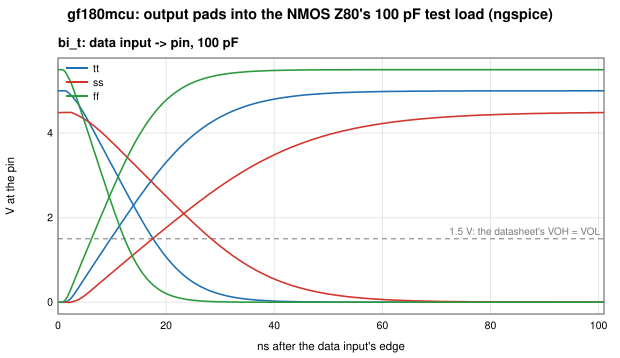
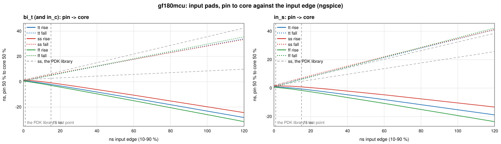

# Transistor-level simulation

The chips' timing checks (`../timing/pin_timing.py`) run on static timing
analysis: cell libraries characterised by the PDKs, measured at 50 % of
each signal's swing. This directory goes below that, to the transistors,
with ngspice and each PDK's own netlists and SPICE models:

- **The pads** (`pads.py`): every I/O pad cell the chips use, simulated
  at the process corners of the chip's STA and fed back into the pin-timing
  check as Liberty files, together with the measuring levels of the
  NMOS Z80's datasheet.
- **The whole chip** (next): the extracted layout of the GF180 chip
  running reset and a few bus cycles, its pins plotted the way the Z80's
  datasheet draws its timing diagrams.

## The pads

The NMOS Z80's AC characteristics (Zilog PS0178, Z8400) are measured
into a 100 pF load, with clock and input edges up to 30 ns (we use 15 ns),
at TTL levels: outputs where they cross 1.5 V (its AC test conditions:
VOH = VOL = 1.5 V), inputs where they cross 2.0 V rising and 0.8 V
falling (VIH, VIL). The PDKs' pad libraries stop well short of that:

| | GF180 `gf180mcu_fd_io` | IHP `sg13g2_io` |
|---|---|---|
| Output loads characterised | to 33 pF (30 + the pad) | to 20 pF |
| Input edges characterised | to 1 ns | to 5 ns |

Beyond its last point STA extrapolates linearly, and it measures every
pin at 50 % of its supply. `pads.py` simulates the pad cells instead,
each configured as `z80_chip.v` ties it:

| PDK | Cells (pins) | Corners (as the chip's STA) |
|---|---|---|
| GF180, both the 7- and 9-track chips | `bi_t` (outputs, data bus): 4 mA (`PDRV1:PDRV0` = 00), slow slew, CMOS input; `in_c` (WAIT INT NMI BUSRQ); `in_s`, Schmitt (CLK RESET) | tt 25 °C 5.0 V, ss 125 °C 4.5 V, ff -40 °C 5.5 V |
| IHP SG13G2 | `IOPadTriOut16mA` (address, MREQ IORQ RD WR), `IOPadInOut16mA` (data), `IOPadOut16mA` (M1 RFSH HALT BUSAK), `IOPadIn` (inputs, CLK) | typ 25 °C 1.2 / 3.3 V, slow 125 °C 1.08 / 3.0 V, fast -40 °C 1.32 / 3.6 V |

and measures:

- **outputs**: data input and output enable to the pin, into 1-250 pF,
  for the input slews of the PDK's tables: delay at 50 % (as the
  libraries) and at 1.5 V, 10-90 % transition; turning on from float;
- **float**: the time from the enable to the driver letting go (its
  current under 10 %), and to the pin moving 0.5 V (the datasheet's float
  level) against 2 kΩ to the other rail;
- **inputs**: pin to core with edges to 30 ns, and the pin's voltage
  where the core side switches, on a fast edge and on a 2 µs ramp;
- **DC drive**: the current the output sinks at 0.4 V and sources at
  2.4 V, against the NMOS Z80's 2.0 mA and 250 µA.

Run it from the repository root (ngspice from `PATH` or nixpkgs; for IHP
also `openvaf-r`, from nixpkgs' `openvaf`, which compiles the PDK's
Verilog-A transistor models; the PDK as the `asic-<pdk>` branch fetches
it, under `~/.ciel`):

    asic/spice/pads.py gf180mcu      # ~624 simulations, 4 min on 8 cores
    asic/spice/pads.py ihp-sg13g2    # ~1700 simulations, 3 min
    asic/spice/pads.py gf180mcu --reuse   # the outputs again from pads.json

Into `pads/<pdk>/` go:

- the PDK's pad Liberty per corner, the used cells' arcs replaced by the
  simulated tables (other drive settings keep the PDK's; delays 50 % to
  50 % and slews 10-90 %, as the PDK's), their `max_capacitance` and
  `max_transition` widened to the simulated range;
- `pads.json`, every measurement, and `summary.txt`;
- `waveforms.svg`, `delay_vs_load.svg`, `inputs.svg`.

### What the transistors say

Outputs into the 100 pF test load, data input to the pin (input slew
0.5 ns); in brackets the PDK library as STA extrapolates it:

| | rise, 50 % | rise, 1.5 V | fall, 50 % | fall, 1.5 V | transition rise / fall |
|---|---|---|---|---|---|
| GF180 `bi_t` 4 mA, tt | 15.1 (15.8) | 9.8 | 13.1 (14.3) | 17.6 | 27.3 / 20.0 |
| GF180, ss | 24.8 (26.0) | 17.5 | 22.0 (24.3) | 28.4 | 45.0 / 34.2 |
| GF180, ff | 10.4 (10.8) | 6.2 | 8.8 (9.6) | 12.3 | 18.5 / 13.4 |
| IHP 16 mA, typ | 12.2 (12.5) | 11.2 | 11.7 (12.0) | 12.8 | 22.4 / 20.7 |
| IHP, slow | 19.1 (19.5) | 19.1 | 18.7 (19.1) | 18.7 | 34.7 / 32.6 |
| IHP, fast | 8.5 (8.8) | 7.2 | 8.3 (8.4) | 9.7 | 15.7 / 14.7 |

The libraries extrapolate the outputs well -- STA is 0.3-2.3 ns
pessimistic at 100 pF, the transitions agree within 0.3 ns
(`delay_vs_load.svg`). What changes is where the datasheet measures: a
5 V output crosses 1.5 V 5-7 ns before its 50 % point when it rises and
4-6 ns after it when it falls. (On IHP's 3.0 V slow corner 1.5 V *is* the
50 % point.) Turn-on from float behaves like the data path; the drivers
let go 0.7-3.2 ns after the enable, and against 2 kΩ the pin has moved
0.5 V after 21-41 ns, mostly the test load's own RC.

Inputs, pin 50 % to core 50 % on a 15 ns edge:

| | rise | fall | switches (DC) |
|---|---|---|---|
| GF180 `in_c` / `bi_t`, tt / ss / ff | -2.1 / -0.9 / -2.9 (PDK: 0.5 / 2.7 / -0.7) | 5.2 / 5.6 / 5.1 (6.8 / 6.5 / 6.7) | 1.34-1.52 V |
| GF180 `in_s` (CLK, RESET) | -0.6 / 0.9 / -1.7 (2.3 / 4.8 / 0.8) | 6.3 / 7.1 / 6.1 (8.0 / 6.6 / 8.1) | up 1.69-1.78 V, down 1.13-1.27 V |
| IHP `IOPadIn`, typ / slow / fast | 0.7 / 1.1 / 0.5 (0.9 / 1.5 / 0.7) | 0.7 / 0.7 / 0.6 (1.1 / 1.2 / 0.9) | 1.54-1.80 V |

The inputs are where the libraries were wrong: GF180's 5 V input switches
near 1.4 V, far below the 2.5 V the libraries measure from, so on a 15 ns
edge the core sees a rising input before the pin is half-way, and a
falling one only when it is nearly down -- up to 4 ns away from the
extrapolation, and in opposite directions for the two edges; the Schmitt
CLK pad's rising edge reaches the core 3.9 ns earlier at the slow corner
than STA thought. Every input switches inside the TTL window (above
0.8 V, below 2.0 V) at every corner, so both chips take TTL levels, as the
NMOS Z80 does; IHP's inputs switch at half their 3.3 V supply.

DC drive: GF180's weakest `bi_t` setting sinks 4.2 mA at 0.4 V and
sources 9.9 mA at 2.4 V at the slow corner (the NMOS Z80: 2.0 mA,
0.25 mA); IHP's 16 mA pad 4.1 and 4.9 mA.

### Into the pin timing

`../timing/pin_timing.py` reads `pads/<pdk>/` when it is there: the
simulated libraries in place of the PDK's, outputs measured at 1.5 V (the
simulated offset from 50 % at the check's load) and inputs at 2.0 / 0.8 V
on the check's edge. The CLK pin stays referenced at its 50 %. The three
chips at 4 MHz, PDK libraries at 50 % against simulated pads at the
datasheet's levels:

| | GF180 7-track | GF180 9-track | IHP |
|---|---|---|---|
| Tightest margin | +0.6 ns (ThINT) -> +6.4 ns (ThBUSREQ) | +0.6 (ThINT) -> +6.4 (ThINT) | +0.5 (ThBUSREQ) -> +1.8 (ThBUSREQ) |
| Opcode setup TsD(Cr), slow corner | +8.9 -> +11.8 ns | +7.1 -> +10.0 | +25.2 -> +28.3 |
| WR pulse width TwWR | +31.6 -> +20.0 ns | +31.5 -> +19.8 | +30.4 -> +27.7 |
| 6 / 8 MHz, simulated pads (tightest) | PASS +6.7 / PASS +1.8 | PASS +5.0 / PASS +0.8 | PASS +1.9 / PASS +1.2 |

The input holds that looked tightest were the libraries' extrapolation:
with the inputs as simulated they have 6 ns and more on GF180. The low
pulses of the 5 V outputs come out shorter at 1.5 V (their falling edge
crosses it late, the rising one early), and all of them stay well
inside the datasheet.

### Notes

- ngspice runs single-threaded (`.spiceinit`): its OpenMP device loading
  costs per model, and GF180's library has hundreds of binned models, so
  with the default 8 threads a pad took ~1000x as long.
- IHP's transistor models are Verilog-A (PSP 103); `pads.py` compiles them
  with `openvaf-r` into the run directory. Its antenna diodes (`darea`,
  `dperim`) carry a 0.7 µs transit time, which made ngspice's timestep
  collapse as an output switched; `pads.py` zeroes it -- the diodes sit
  reverse-biased on the output transistors' gates and keep their
  capacitance and leakage (removing them outright changes no delay by
  0.01 ns) -- and joins IHP's substrate node (`sub!`) into one.
- The loads start at 1 pF: with none at all, GF180's slow corner also
  stalls ngspice's timestep, and a pin always carries some.
- The PDK versions are the chips': GF180 `54435919` (LibreLane 3.0.14's),
  IHP `7bbb4b5a` (IHP's chip template).
