# Transistor-level simulation

The chips' timing checks (`../timing/pin_timing.py`) run on static timing
analysis: cell libraries characterised by the PDKs, measured at 50 % of
each signal's swing. This directory goes below that, to the transistors,
with ngspice and each PDK's own netlists and SPICE models:

- **The pads** (`pads.py`): every I/O pad cell the chips use, simulated
  at the process corners of the chip's STA and fed back into the pin-timing
  check as Liberty files, together with the measuring levels of the
  NMOS Z80's datasheet; `findings.py` plots what that changed.
- **The NMI pulse catcher** (`nmi.py`): the one place in the chips where
  a pin clocks a flip-flop, cut out of the GF180 chip from the NMI and CLK
  pins to its flip-flops, and run at three corners.
- **The whole chip** (`chip.py`): the extracted layout of the GF180 chip
  running reset and a short program at three corners, its pins drawn the
  way the Z80's datasheet draws its timing diagrams.

The pads and the NMI catcher run in CI, and their figures are on the
project's GitHub Pages site, under "At transistor level" (see [CI](#ci)).

## The pads

The NMOS Z80's AC characteristics (Zilog PS0178, Z8400) are measured
into a 100 pF load, with clock and input edges up to 30 ns (we use 15 ns),
at TTL levels: outputs where they cross 1.5 V (its AC test conditions:
VOH = VOL = 1.5 V), inputs where they cross 2.0 V rising and 0.8 V
falling (VIH, VIL). The PDKs' pad libraries stop well short of that:

| | GF180 `gf180mcu_fd_io` | IHP `sg13g2_io` |
|---|---|---|
| Output loads characterised | to 33 pF (30 + the pad) | to 20 pF |
| Input edges characterised | to 1 ns | to 5 ns |

Beyond its last point STA extrapolates linearly, and it measures every
pin at 50 % of its supply. `pads.py` simulates the pad cells instead,
each configured as `z80_chip.v` ties it:

| PDK | Cells (pins) | Corners (as the chip's STA) |
|---|---|---|
| GF180, both the 7- and 9-track chips | `bi_t` (outputs, data bus): 4 mA (`PDRV1:PDRV0` = 00), slow slew, CMOS input; `in_c` (WAIT INT NMI BUSRQ); `in_s`, Schmitt (CLK RESET) | tt 25 °C 5.0 V, ss 125 °C 4.5 V, ff -40 °C 5.5 V |
| IHP SG13G2 | `IOPadTriOut16mA` (address, MREQ IORQ RD WR), `IOPadInOut16mA` (data), `IOPadOut16mA` (M1 RFSH HALT BUSAK), `IOPadIn` (inputs, CLK) | typ 25 °C 1.2 / 3.3 V, slow 125 °C 1.08 / 3.0 V, fast -40 °C 1.32 / 3.6 V |

and measures:

- **outputs**: data input and output enable to the pin, into 1-250 pF,
  for the input slews of the PDK's tables: delay at 50 % (as the
  libraries) and at 1.5 V, 10-90 % transition; turning on from float;
- **float**: the time from the enable to the driver letting go (its
  current under 10 %), and to the pin moving 0.5 V (the datasheet's float
  level) against 2 kΩ to the other rail;
- **inputs**: pin to core with edges to 30 ns, and the pin's voltage
  where the core side switches, on a fast edge and on a 2 µs ramp;
- **DC drive**: the current the output sinks at 0.4 V and sources at
  2.4 V, against the NMOS Z80's 2.0 mA and 250 µA.

Run it from the repository root. The simulators are pinned, and built
with nix on first use (`pads.TOOLS`; without nix, whatever is on `PATH`):
ngspice 45, and for IHP OpenVAF's `openvaf-r`, which compiles the PDK's
Verilog-A transistor models. The PDK is the one the `asic-<pdk>` branch
fetches, under `~/.ciel`:

    asic/spice/pads.py gf180mcu      # ~624 simulations, 4 min on 8 cores
    asic/spice/pads.py ihp-sg13g2    # ~1700 simulations, 3 min
    asic/spice/pads.py gf180mcu --reuse   # the outputs again from pads.json
    asic/spice/pads.py gf180mcu --out /tmp/pads --check asic/spice/pads/gf180mcu/pads.json

`--check` fails when a result moved from the committed one by more than
0.1 ns or 3 % (delays, slews), 0.03 V (switching levels) or 3 % (drive
currents) -- what CI runs.

Into `pads/<pdk>/` go:

- the PDK's pad Liberty per corner, the used cells' arcs replaced by the
  simulated tables (other drive settings keep the PDK's; delays 50 % to
  50 % and slews 10-90 %, as the PDK's), their `max_capacitance` and
  `max_transition` widened to the simulated range;
- `pads.json`, every measurement, and `summary.txt`;
- `waveforms.svg`, `delay_vs_load.svg`, `inputs.svg`: the corners side by
  side;
- a figure per kind of pin, every corner in it: `out.svg` (the outputs'
  edges into the test load), `tristate.svg` (the data bus turning on, and
  letting go), `in.svg` (the inputs: pin and core side on 15 ns edges,
  and where they switch on a slow ramp), `clk_reset.svg` (GF180's Schmitt
  input, CLK and RESET; IHP's take the plain input pad).

### What the transistors say

Outputs into the 100 pF test load, data input to the pin (input slew
0.5 ns); in brackets the PDK library as STA extrapolates it:

| | rise, 50 % | rise, 1.5 V | fall, 50 % | fall, 1.5 V | transition rise / fall |
|---|---|---|---|---|---|
| GF180 `bi_t` 4 mA, tt | 15.1 (15.8) | 9.8 | 13.1 (14.3) | 17.6 | 27.3 / 20.0 |
| GF180, ss | 24.8 (26.0) | 17.5 | 22.0 (24.3) | 28.4 | 45.0 / 34.2 |
| GF180, ff | 10.4 (10.8) | 6.2 | 8.8 (9.6) | 12.3 | 18.5 / 13.4 |
| IHP 16 mA, typ | 12.2 (12.5) | 11.2 | 11.7 (12.0) | 12.8 | 22.4 / 20.7 |
| IHP, slow | 19.1 (19.5) | 19.1 | 18.7 (19.1) | 18.7 | 34.7 / 32.6 |
| IHP, fast | 8.5 (8.8) | 7.2 | 8.3 (8.4) | 9.7 | 15.7 / 14.7 |

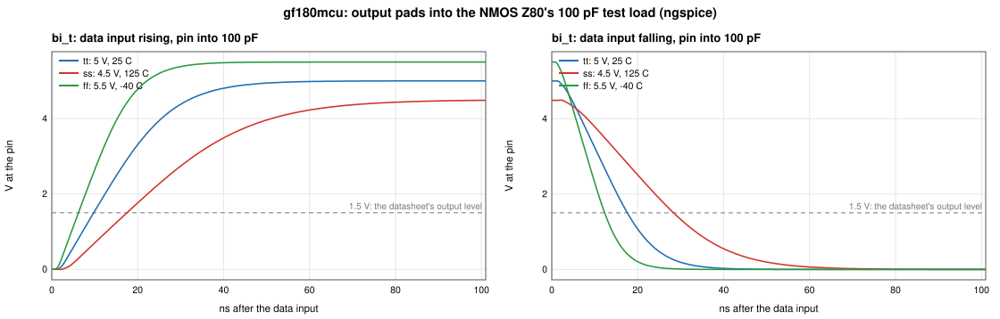

The libraries extrapolate the outputs well -- STA is 0.3-2.3 ns
pessimistic at 100 pF, the transitions agree within 0.3 ns
(`delay_vs_load.svg`). What changes is where the datasheet measures: a
5 V output crosses 1.5 V 5-7 ns before its 50 % point when it rises and
4-6 ns after it when it falls. (On IHP's 3.0 V slow corner 1.5 V *is* the
50 % point.) Turn-on from float behaves like the data path; the drivers
let go 0.7-3.2 ns after the enable, and against 2 kΩ the pin has moved
0.5 V after 21-41 ns, mostly the test load's own RC.

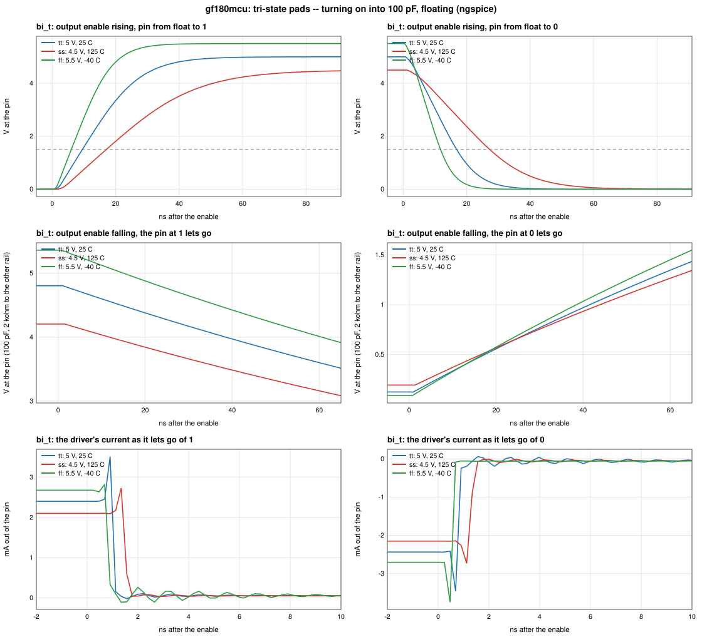

Inputs, pin 50 % to core 50 % on a 15 ns edge:

| | rise | fall | switches (DC) |
|---|---|---|---|
| GF180 `in_c` / `bi_t`, tt / ss / ff | -2.1 / -0.9 / -2.9 (PDK: 0.5 / 2.7 / -0.7) | 5.2 / 5.6 / 5.1 (6.8 / 6.5 / 6.7) | 1.34-1.52 V |
| GF180 `in_s` (CLK, RESET) | -0.6 / 0.9 / -1.7 (2.3 / 4.8 / 0.8) | 6.3 / 7.1 / 6.1 (8.0 / 6.6 / 8.1) | up 1.69-1.78 V, down 1.13-1.27 V |
| IHP `IOPadIn`, typ / slow / fast | 0.7 / 1.1 / 0.5 (0.9 / 1.5 / 0.7) | 0.7 / 0.7 / 0.6 (1.1 / 1.2 / 0.9) | 1.54-1.80 V |

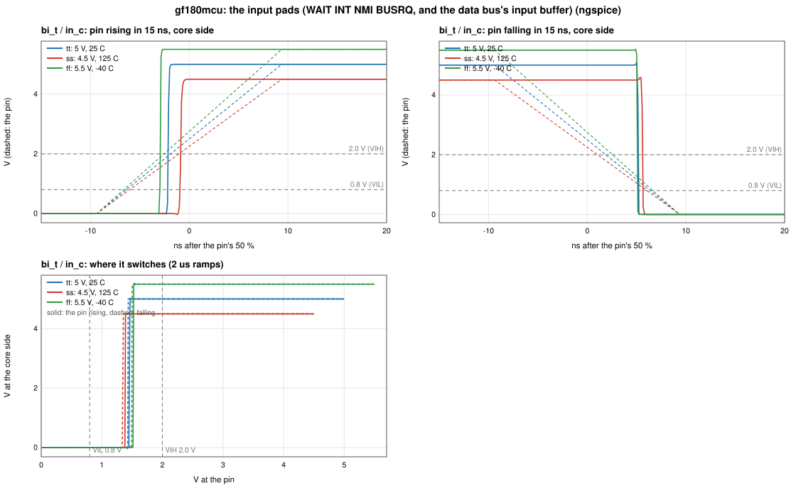

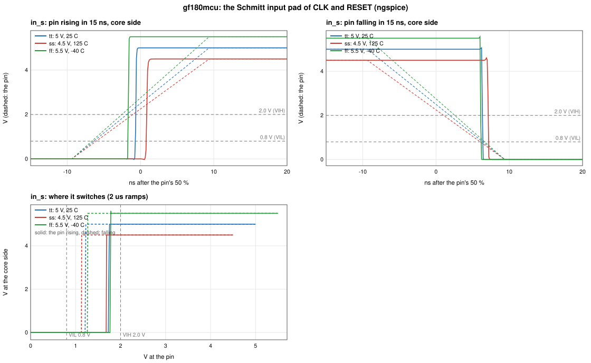

The inputs are where the libraries were wrong: GF180's 5 V input switches
near 1.4 V, far below the 2.5 V the libraries measure from, so on a 15 ns
edge the core sees a rising input before the pin is half-way, and a
falling one only when it is nearly down -- up to 4 ns away from the
extrapolation, and in opposite directions for the two edges; the Schmitt
CLK pad's rising edge reaches the core 3.9 ns earlier at the slow corner
than STA thought. Every input switches inside the TTL window (above
0.8 V, below 2.0 V) at every corner, so both chips take TTL levels, as the
NMOS Z80 does; IHP's inputs switch at half their 3.3 V supply.

DC drive: GF180's weakest `bi_t` setting sinks 4.2 mA at 0.4 V and
sources 9.9 mA at 2.4 V at the slow corner (the NMOS Z80: 2.0 mA,
0.25 mA); IHP's 16 mA pad 4.1 and 4.9 mA.

### Into the pin timing

`../timing/pin_timing.py` reads `pads/<pdk>/` when it is there: the
simulated libraries in place of the PDK's, outputs measured at 1.5 V (the
simulated offset from 50 % at the check's load) and inputs at 2.0 / 0.8 V
on the check's edge. The CLK pin stays referenced at its 50 %. The three
chips at 4 MHz, PDK libraries at 50 % against simulated pads at the
datasheet's levels:

| | GF180 7-track | GF180 9-track | IHP |
|---|---|---|---|
| Tightest margin | +0.6 ns (ThINT) -> +6.4 ns (ThBUSREQ) | +0.6 (ThINT) -> +6.4 (ThINT) | +0.5 (ThBUSREQ) -> +1.8 (ThBUSREQ) |
| Opcode setup TsD(Cr), slow corner | +8.9 -> +11.8 ns | +7.1 -> +10.0 | +25.2 -> +28.3 |
| WR pulse width TwWR | +31.6 -> +20.0 ns | +31.5 -> +19.8 | +30.4 -> +27.7 |
| 6 / 8 MHz, simulated pads (tightest) | PASS +6.7 / PASS +1.8 | PASS +5.0 / PASS +0.8 | PASS +1.9 / PASS +1.2 |

The input holds that looked tightest were the libraries' extrapolation:
with the inputs as simulated they have 6 ns and more on GF180. The low
pulses of the 5 V outputs come out shorter at 1.5 V (their falling edge
crosses it late, the rising one early), and all of them stay well
inside the datasheet.

### In plots

`findings.py` draws the above from `pads/<pdk>/pads.json` and from
`pin_timing.py`'s output on each chip's run with the simulated pads and
with `--pads none` (`findings/pin_timing/` holds a set):

    asic/spice/findings.py           # findings/*.svg

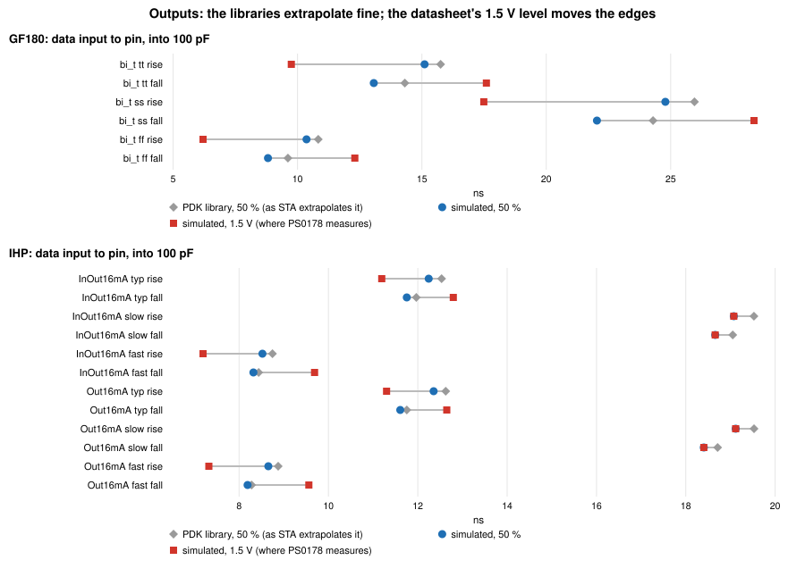

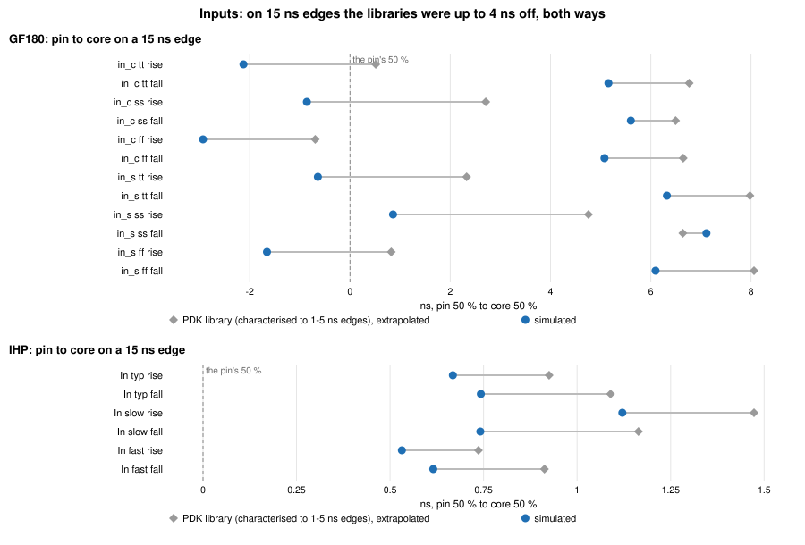

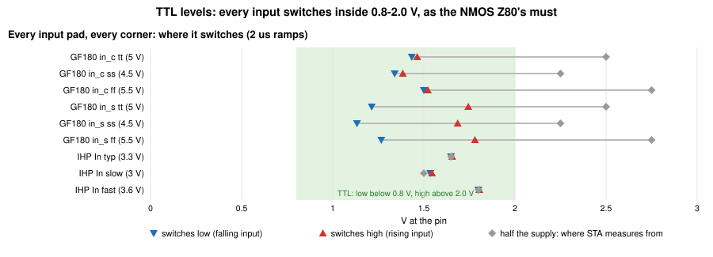

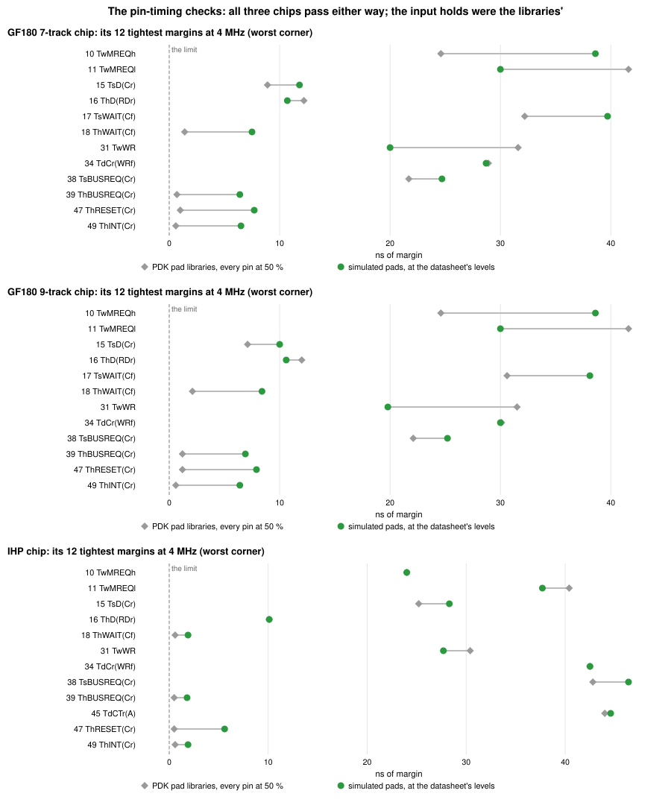

### Notes

- ngspice runs single-threaded (`.spiceinit`): its OpenMP device loading
  costs per model, and GF180's library has hundreds of binned models, so
  with the default 8 threads a pad took ~1000x as long.
- IHP's transistor models are Verilog-A (PSP 103); `pads.py` compiles them
  with `openvaf-r` into the run directory. Its antenna diodes (`darea`,
  `dperim`) carry a 0.7 µs transit time, which made ngspice's timestep
  collapse as an output switched; `pads.py` zeroes it -- the diodes sit
  reverse-biased on the output transistors' gates and keep their
  capacitance and leakage (removing them outright changes no delay by
  0.01 ns) -- and joins IHP's substrate node (`sub!`) into one.
- The loads start at 1 pF: with none at all, GF180's slow corner also
  stalls ngspice's timestep, and a pin always carries some.
- The PDK versions are the chips': GF180 `54435919` (LibreLane 3.0.14's),
  IHP `7bbb4b5a` (IHP's chip template).

## The NMI pulse catcher

The NMOS Z80 takes an NMI pulse of any width -- TwNMI, 80 ns at 4 MHz, is
less than half a clock -- because its NMI flip-flop is set by the pin's
falling edge itself, not by a clock edge sampling the pin. `z80_top` does
the same in front of the core's edge detect (`rtl/z80_top.v`): `nmi_hold`,
a flip-flop clocked by the NMI pin with D tied high, holds NMI asserted for
the core (`nmi_n_held`) until a rising CLK edge has seen it, and
`nmi_hold_clr` then clears it. It is the one place in the chips where a
pin clocks a flip-flop, and the clear races the clock edge that samples
`nmi_n_held`, so `nmi.py` simulates it.

The cut goes from the NMI and CLK pins to the first flip-flops: the two
input pads, NMI's port buffer, the clock tree from the CLK pad to the leaf
that clocks the catcher, the catcher's two flip-flops, its NOR and
inverter, and the falling-edge sampler `nmi_n_neg`. `nmi.py` finds it in
the chip's gate-level netlists by the RTL's net names and follows it back
through buffers and inverters to the pins. The cells are extracted with
Magic from the PDK's own layouts (the PDK's cell netlists carry no
junction areas, and came out too fast), the wires come from the routed
chip's SPEF,
and every net also carries the input capacitance of the cells on it that
the cut leaves out. A minute per corner, the three side by side; with
`--magic WORK` the cut comes out of `chip.py`'s extraction of the whole
chip instead, which agrees within 0.5 ns at tt (the clear within 0.1 ns).

    asic/spice/nmi.py <asic-gf180mcu chip run>     # chip/gf180mcu/nmi_*.svg, nmi_<corner>.json

Six cases at 4 MHz, 15 ns edges on both pins:

| | the NMI pulse | |
|---|---|---|
| A | 80 ns (TwNMI), in the low half of the clock | |
| B | 20 ns, a quarter of TwNMI | |
| C | falling 5 ns before a rising CLK edge | held to the edge after it |
| D | falling 5 ns after a rising CLK edge | |
| E | two 25 ns pulses before one rising edge | one NMI |
| F | a second 40 ns pulse in the high half after the edge that clears the first | lost |

A, B, E and F sit in the middle of a clock phase, clear of CLK's edges;
C and D are about the edge.

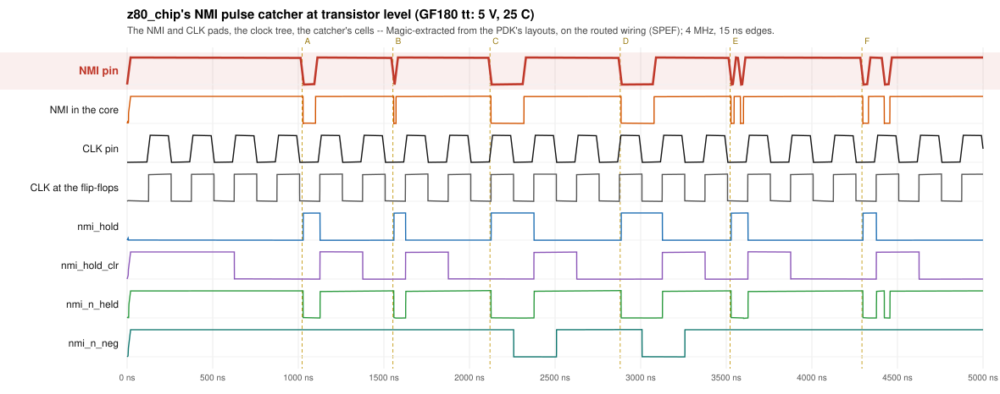

Every pulse is caught at every corner, B's 20 ns too. Case A, from the
pin's 50 % to the node's:

| | NMI pin falls -> `nmi_hold` set | CLK pin rises -> `nmi_hold_clr` | the core sees NMI for |
|---|---|---|---|
| tt, 5.0 V, 25 °C | 6.3 ns | 1.5 ns | 99.3 ns |
| ss, 4.5 V, 125 °C | 8.1 ns | 4.6 ns | 102.0 ns |
| ff, 5.5 V, -40 °C | 5.4 ns | -0.3 ns | 97.8 ns |

At ff the clear comes before the CLK pin is half-way up: on the 15 ns
edge the Schmitt pad switches near 1.8 V, its core side rising 1.7 ns
before the pin's 50 %, and the clock tree and flip-flop behind it take
less than that. Nothing depends on the pin's 50 % though -- the clear races the core's own
flip-flops, clocked by the same early edge through the same tree, and
must come after their hold time. OpenSTA times that race only through the
flip-flop's asynchronous clear arc, which it skips by default (as in the
flow's sign-off) until `set sta_preset_clear_arcs_enabled 1`: then it has
+2.0 and +2.2 ns of hold margin at tt and +1.2 and +1.3 ns at ff, for the
two flip-flops that sample `nmi_n_held`.

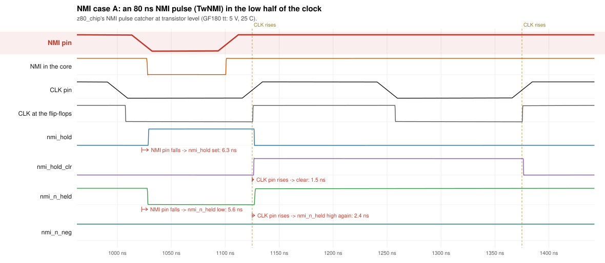

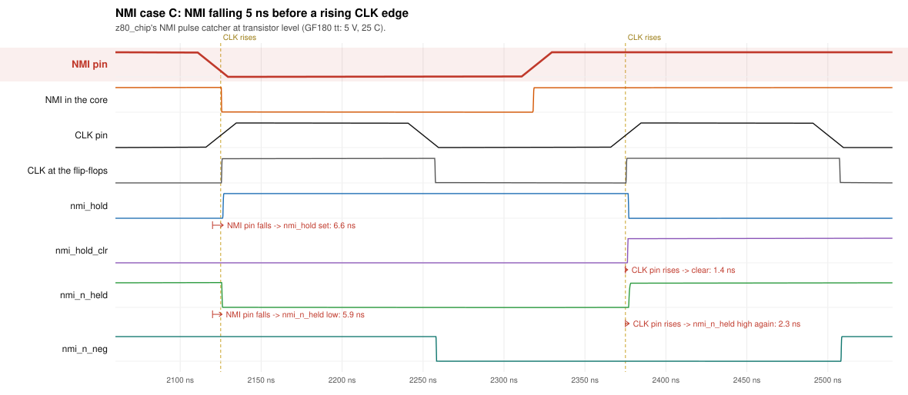

Case F: while `nmi_hold_clr` is high -- one clock -- the catcher cannot be
set, and a pulse that starts and ends inside the clock's high half is
gone before either sampler looks. On the NMOS Z80 a second falling edge
sets the NMI flip-flop again; if the first NMI is still pending, the two
are one NMI there too. Only when the core accepts the first NMI at exactly
the edge between the two pulses would the NMOS Z80 take a second one and
this chip not: two NMI pulses within a clock of each other.

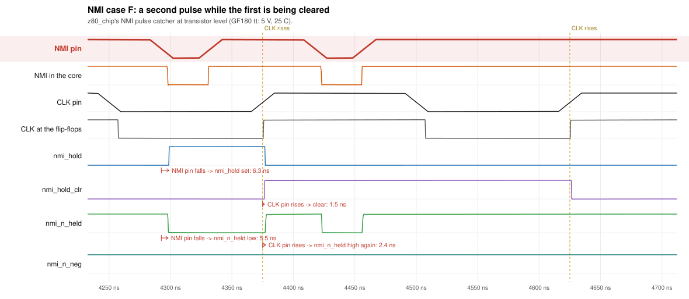

The ss and ff figures are beside them (`nmi_<case>_<corner>.svg`).
Different Magic versions extract the cells' parasitics differently
(8.3.681 moved tt's clear by 0.3 ns from 8.3.623, LibreLane 3.0.14's), so
`nmi.py` uses LibreLane's.

## The whole chip

`chip.py` extracts the GF180 7-track chip's routed layout with Magic --
66,652 transistors, leaving out the decoupling and fill cells, with every
net's wiring capacitance lumped to ground -- and runs it in ngspice from
power-up: four clocks of RESET, then a short program at 4 MHz with 15 ns
clock edges and 100 pF on every pin:

    0000  LD A,5Ah        opcode fetch, memory read
    0002  LD (8000h),A    ... memory write
    0005  OUT (42h),A     ... I/O write
    0007  IN A,(43h)      ... I/O read (the port answers A5h)
    0009  HALT

The same program on the RTL (`tb_chip_ref.v`, iverilog) gives the pins at
every clock edge, and when the memory has to drive the data bus: a source
behind a 50 Ω switch drives the RTL's byte from 40 ns after RD falls to
60 ns after the read ends. The transistors' pins are checked against the
RTL's at every clock edge after RESET, and every output parameter of the
datasheet is measured on every cycle that has it -- CLK at 50 %, outputs
at 1.5 V -- against its limit and STA's number. The figures are the
datasheet's: the opcode fetch (PS0178 Figure 5), memory read and write
(Figure 6), I/O write and read (Figure 7), and the whole run as a logic
analyser shows it.

    asic/spice/chip.py <asic-gf180mcu chip run> --corner tt --sta <pin_timing.py output>

`--corner ss` and `--corner ff` run the slow (4.5 V, 125 °C) and the fast
(5.5 V, -40 °C) corner. tt's figures and `results.json` are committed in
`chip/gf180mcu/`, ss's and ff's in `chip/gf180mcu/ss/` and
`chip/gf180mcu/ff/`:

| Corner | Pins against the RTL | AC parameters met | Closest to its limit |
|---|---|---|---|
| tt, 5.0 V, 25 °C | 0 mismatches | 25 of 25 | TwWR, 21.8 ns over |
| ss, 4.5 V, 125 °C | 0 mismatches | 25 of 25 | TwWR, 18.3 ns over |
| ff, 5.5 V, -40 °C | 0 mismatches | 25 of 25 | TwWR, 23.7 ns over |

The clock's edges need short steps. Left to its step control (on the
devices' charges), ngspice took each edge -- the CLK pad's Schmitt
trigger, the clock tree and every flip-flop behind it -- in one 1-2 ns
step, which collapses the delays inside it: at tt a flip-flop settled in
its old state (the OUT cycle's IORQ fell half a clock late), at ff
latches elsewhere flipped with their clocks still. A source that only
makes breakpoints, every 0.5 ns from just before the CLK pin crosses the
pad's threshold to 7 ns after (`clock_breaks()`), keeps those steps at
0.2 ns or less; with it no probed flip-flop changes state without an
active edge of its clock, at any corner.

KLU's sparse factorisation dominates: ngspice simulates about 40 ns a
minute, some six hours for the program at tt alone; with the clock's
breakpoints and the three corners side by side on four cores, about 13
hours each.

## CI

- `targets.yml`'s `spice` job (`.github/workflows/spice-pads.yml`, ~10 min a
  PDK): `pads.py --check` for GF180 and IHP against the committed
  `pads.json`, its figures as the artifact `spice-pads-<pdk>`.
- `asic-pdk.yml`, GF180 7-track: after the chip's pin timing, `nmi.py`
  at three corners (~2 min), failing when a case's pulse is not caught,
  held for the core and cleared.
- `pages.yml` puts the pads, the NMI catcher and the committed whole-chip
  runs under "At transistor level" on the project's site, and the latest
  `transistor.yml` run on its own page, `transistor/`, linked from there.
- `transistor.yml`, by hand (Actions, "Transistor", Run workflow): the
  whole chip at the three corners. It extracts the GDS of main's latest
  Targets run, runs the program in four windows of about 3.3 µs, one job
  each (a job stops at 6 hours; `chip.py --segment K/4`), and puts the
  stitched run's figures and `results.json` in the artifact
  `transistor-gf180mcu`, laid out as `chip/gf180mcu/`.

A window starts from the node voltages the one before ended with
(ngspice's `wrnodev`, as `.ic`), with every source shifted to its start.
The cuts sit 15 ns before a clock edge, where the chip has settled.
`wrnodev` leaves out every node whose name has a `#` -- ngspice keeps those
for devices' own internal nodes -- and Magic names every node inside a
standard cell that way, so the first run on GitHub restarted each window
with the latches inside every flip-flop at 0 V: its pins left the RTL's at
the first clock edge after the first cut. `chip.py` renames them
(`a_<x>_<y>_h`); a flip-flop restarted while its clock is high keeps its
state. A run whose pins differ from the RTL's or that fails an AC
parameter fails, and `pages.yml` publishes no such run. ngspice's own
snapshots (`snsave` / `snload`) would keep the integrator's history too,
but `snload` crashes on a KLU circuit.
