# Transistor-level simulation

The chips' timing checks (`../timing/pin_timing.py`) run on static timing
analysis: cell libraries characterised by the PDKs, measured at 50 % of
each signal's swing. This directory goes below that, to the transistors,
with ngspice and each PDK's own netlists and SPICE models:

- **The pads** (`pads.py`): every I/O pad cell the chips use, simulated
  at the process corners of the chip's STA and fed back into the pin-timing
  check as Liberty files, together with the measuring levels of the
  NMOS Z80's datasheet; `findings.py` plots what that changed.
- **The NMI pulse catcher** (`nmi.py`): the one place in the chips where
  a pin clocks a flip-flop, cut out of the GF180 chip from the NMI and CLK
  pins to its flip-flops, and run at three corners.
- **The whole chip** (`chip.py`): the extracted layout of the GF180 chip
  running reset and a short program at three corners, its pins drawn the
  way the Z80's datasheet draws its timing diagrams.

The pads and the NMI catcher run in CI, and their figures are on the
project's GitHub Pages site, under "At transistor level" (see [CI](#ci)).

## The pads

The NMOS Z80's AC characteristics (Zilog PS0178, Z8400) are measured
into a 100 pF load, with clock and input edges up to 30 ns (we use 15 ns),
at TTL levels: outputs where they cross 1.5 V (its AC test conditions:
VOH = VOL = 1.5 V), inputs where they cross 2.0 V rising and 0.8 V
falling (VIH, VIL). The PDKs' pad libraries stop well short of that:

| | GF180 `gf180mcu_fd_io` | IHP `sg13g2_io` |
|---|---|---|
| Output loads characterised | to 33 pF (30 + the pad) | to 20 pF |
| Input edges characterised | to 1 ns | to 5 ns |

Beyond its last point STA extrapolates linearly, and it measures every
pin at 50 % of its supply. `pads.py` simulates the pad cells instead,
each configured as `z80_chip.v` ties it:

| PDK | Cells (pins) | Corners (as the chip's STA) |
|---|---|---|
| GF180, both the 7- and 9-track chips | `bi_t` (outputs, data bus): 4 mA (`PDRV1:PDRV0` = 00), slow slew, CMOS input; `in_c` (WAIT INT NMI BUSRQ); `in_s`, Schmitt (CLK RESET) | tt 25 °C 5.0 V, ss 125 °C 4.5 V, ff -40 °C 5.5 V |
| IHP SG13G2 | `IOPadTriOut16mA` (address, MREQ IORQ RD WR), `IOPadInOut16mA` (data), `IOPadOut16mA` (M1 RFSH HALT BUSAK), `IOPadIn` (inputs, CLK) | typ 25 °C 1.2 / 3.3 V, slow 125 °C 1.08 / 3.0 V, fast -40 °C 1.32 / 3.6 V |

and measures:

- **outputs**: data input and output enable to the pin, into 1-250 pF,
  for the input slews of the PDK's tables: delay at 50 % (as the
  libraries) and at 1.5 V, 10-90 % transition; turning on from float;
- **float**: the time from the enable to the driver letting go (its
  current under 10 %), and to the pin moving 0.5 V (the datasheet's float
  level) against 2 kΩ to the other rail;
- **inputs**: pin to core with edges to 120 ns -- past the slowest edge
  an output makes into 250 pF (GF180's `bi_t` at ss, 111 ns), which a
  bidirectional pad's own input sees -- and the pin's voltage where the
  core side switches, on a fast edge and on a 2 µs ramp;
- **DC drive**: the current the output sinks at 0.4 V and sources at
  2.4 V, against the NMOS Z80's 2.0 mA and 250 µA;
- **energy**: in those same runs, the energy the core and the I/O
  supply each deliver for every edge (data, turning on and letting go,
  inputs), and each state's leakage -- the pads' power. The PDKs' power
  tables stop where their timing does, and at 100 pF STA extrapolates
  GF180's to negative energies.

Run it from the repository root. The simulators are pinned, and built
with nix on first use (`pads.TOOLS`; without nix, whatever is on `PATH`):
ngspice 45, and for IHP OpenVAF's `openvaf-r`, which compiles the PDK's
Verilog-A transistor models. The PDK is the one the `asic-<pdk>` branch
fetches, under `~/.ciel`:

    asic/spice/pads.py gf180mcu      # 759 simulations, 7 min on 7 cores
    asic/spice/pads.py ihp-sg13g2    # 1839 simulations, 6 min
    asic/spice/pads.py gf180mcu --reuse   # the outputs again from pads.json
    asic/spice/pads.py gf180mcu --out /tmp/pads --check asic/spice/pads/gf180mcu/pads.json

`--check` fails when a result moved from the committed one by more than
0.1 ns or 3 % (delays, slews), 0.03 V (switching levels), 3 % (drive
currents), 0.5 pJ or 1 % (the supplies' energy) or 5 % (leakage) -- what
CI runs.

Into `pads/<pdk>/` go:

- the PDK's pad Liberty per corner, the used cells' arcs replaced by the
  simulated tables (other drive settings keep the PDK's; delays 50 % to
  50 % and slews 10-90 %, as the PDK's), and the simulated range as the
  pins' `max_transition` / `max_capacitance`: the pad pin's edges to 120
  ns, an output's load to 250 pF beyond its own, the core side's to the
  tables' last points -- so STA flags a pin driven past what was
  simulated (pads.py fails if an output's edge outruns the input edges);
  and their internal and leakage power from the simulated energies (see
  [Power](#power));
- `pads.json`, every measurement, and `summary.txt`;
- `waveforms.svg`, `delay_vs_load.svg`, `energy_vs_load.svg`,
  `inputs.svg`: the corners side by side;
- a figure per kind of pin, every corner in it: `out.svg` (the outputs'
  edges into the test load), `tristate.svg` (the data bus turning on, and
  letting go), `in.svg` (the inputs: pin and core side on 15 ns edges,
  and where they switch on a slow ramp), `clk_reset.svg` (GF180's Schmitt
  input, CLK and RESET; IHP's take the plain input pad).

### What the transistors say

Outputs into the 100 pF test load, data input to the pin (input slew
0.5 ns); in brackets the PDK library as STA extrapolates it:

| | rise, 50 % | rise, 1.5 V | fall, 50 % | fall, 1.5 V | transition rise / fall |
|---|---|---|---|---|---|
| GF180 `bi_t` 4 mA, tt | 15.1 (15.8) | 9.8 | 13.1 (14.3) | 17.6 | 27.3 / 20.0 |
| GF180, ss | 24.8 (26.0) | 17.5 | 22.0 (24.3) | 28.4 | 45.0 / 34.2 |
| GF180, ff | 10.4 (10.8) | 6.2 | 8.8 (9.6) | 12.3 | 18.5 / 13.4 |
| IHP 16 mA, typ | 12.2 (12.5) | 11.2 | 11.7 (12.0) | 12.8 | 22.4 / 20.7 |
| IHP, slow | 19.1 (19.5) | 19.1 | 18.7 (19.1) | 18.7 | 34.7 / 32.6 |
| IHP, fast | 8.5 (8.8) | 7.2 | 8.3 (8.4) | 9.7 | 15.7 / 14.7 |

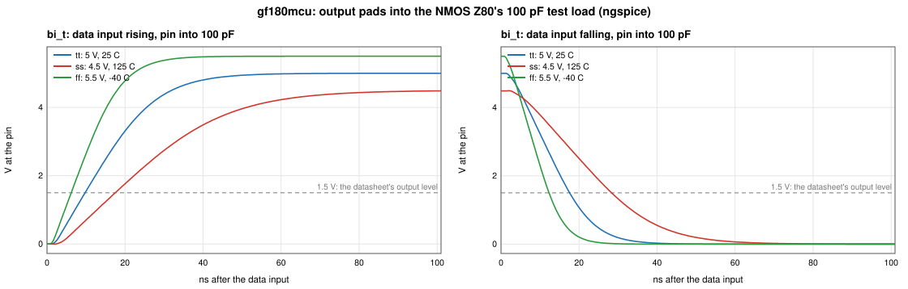

The libraries extrapolate the outputs well -- STA is 0.3-2.3 ns
pessimistic at 100 pF, the transitions agree within 0.3 ns
(`delay_vs_load.svg`). What changes is where the datasheet measures: a
5 V output crosses 1.5 V 5-7 ns before its 50 % point when it rises and
4-6 ns after it when it falls. (On IHP's 3.0 V slow corner 1.5 V *is* the
50 % point.) Turn-on from float behaves like the data path; the drivers
let go 0.7-3.2 ns after the enable, and against 2 kΩ the pin has moved
0.5 V after 21-41 ns, mostly the test load's own RC.

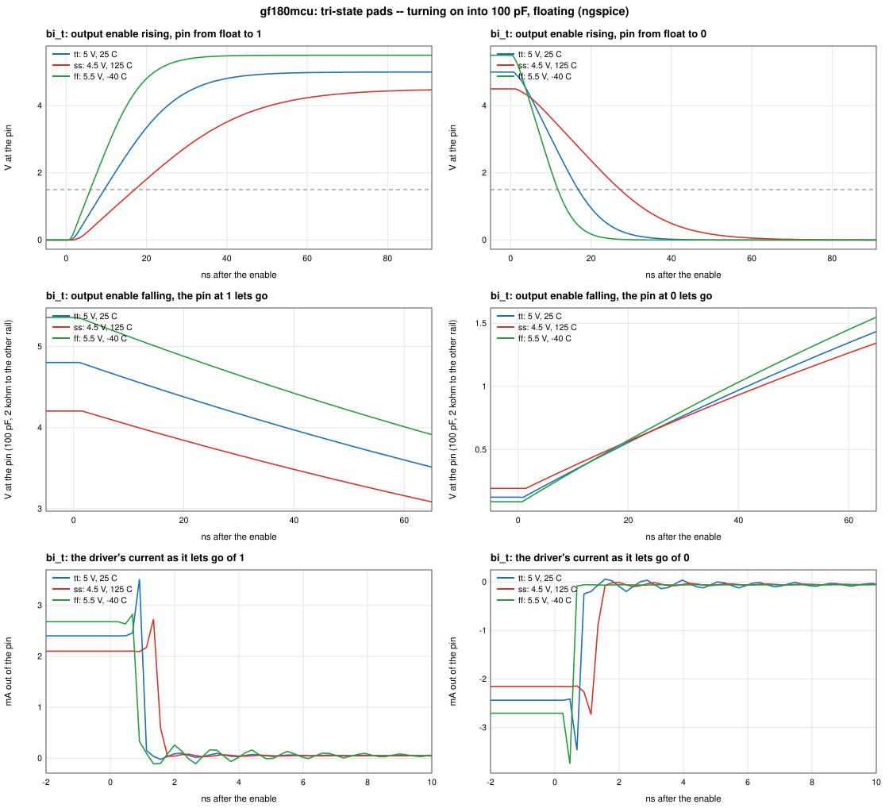

Inputs, pin 50 % to core 50 % on a 15 ns edge:

| | rise | fall | switches (DC) |
|---|---|---|---|
| GF180 `in_c` / `bi_t`, tt / ss / ff | -2.1 / -0.9 / -2.9 (PDK: 0.5 / 2.7 / -0.7) | 5.2 / 5.6 / 5.1 (6.8 / 6.5 / 6.7) | 1.34-1.52 V |
| GF180 `in_s` (CLK, RESET) | -0.6 / 0.9 / -1.7 (2.3 / 4.8 / 0.8) | 6.3 / 7.1 / 6.1 (8.0 / 6.6 / 8.1) | up 1.69-1.78 V, down 1.13-1.27 V |
| IHP `IOPadIn`, typ / slow / fast | 0.7 / 1.1 / 0.5 (0.9 / 1.5 / 0.7) | 0.7 / 0.7 / 0.6 (1.1 / 1.2 / 0.9) | 1.54-1.80 V |

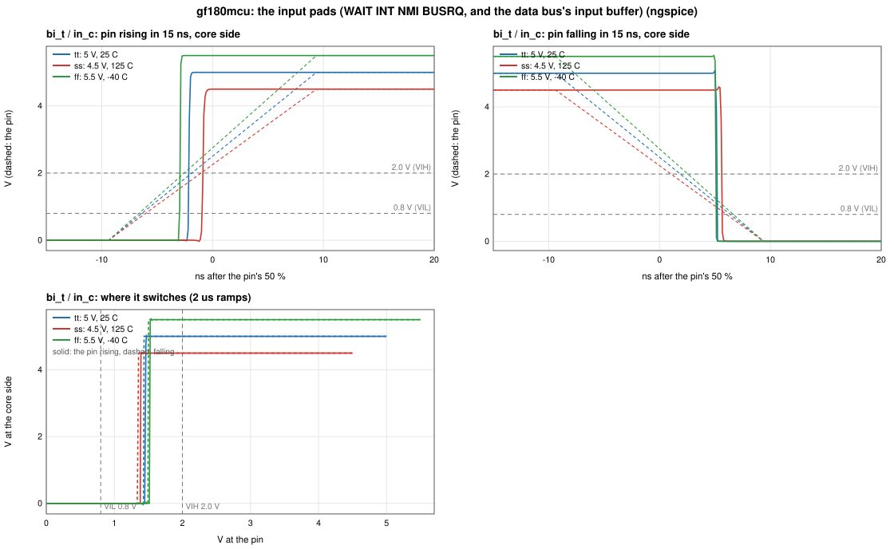

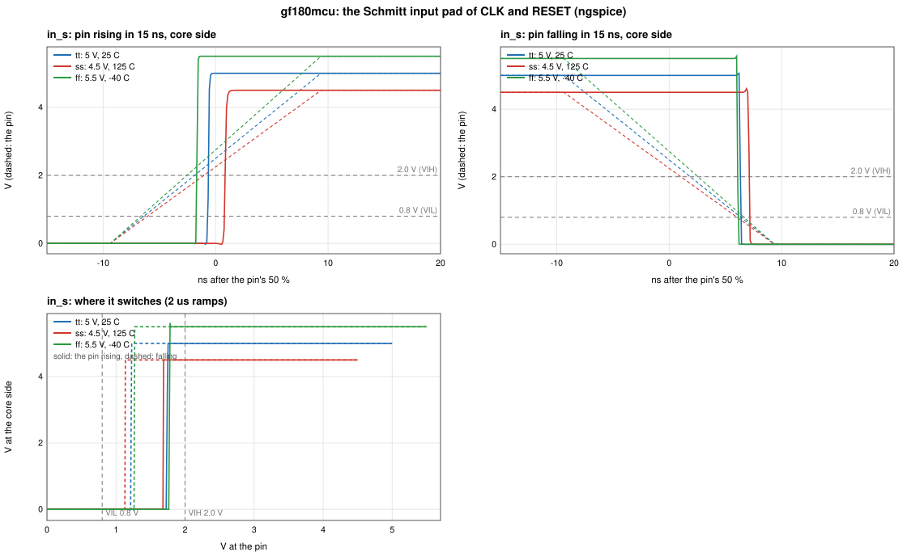

The inputs are where the libraries were wrong: GF180's 5 V input switches
near 1.4 V, far below the 2.5 V the libraries measure from, so on a 15 ns
edge the core sees a rising input before the pin is half-way, and a
falling one only when it is nearly down -- up to 4 ns away from the
extrapolation, and in opposite directions for the two edges; the Schmitt
CLK pad's rising edge reaches the core 3.9 ns earlier at the slow corner
than STA thought. Every input switches inside the TTL window (above
0.8 V, below 2.0 V) at every corner, so both chips take TTL levels, as the
NMOS Z80 does; IHP's inputs switch at half their 3.3 V supply.

DC drive: GF180's weakest `bi_t` setting sinks 4.2 mA at 0.4 V and
sources 9.9 mA at 2.4 V at the slow corner (the NMOS Z80: 2.0 mA,
0.25 mA); IHP's 16 mA pad 4.1 and 4.9 mA.

### Power

In the same runs `pads.py` sums each supply's current over every edge --
the trapezoid over ngspice's own time points, which under its trapezoidal
integration is the capacitors' charge exactly (the supplies' currents ring
in sign from one point to the next, and that cancels over whole steps) --
and measures each state's leakage at DC. The libraries' internal power
follows the PDKs' convention, which their own tables give away: GF180's
vary with load as a rise's energy less the C V² that charges the load
from the supply, and a fall's as measured (not as half of C V² off each
edge). STA counts the pin's own capacitance in the load too, as the
timing tables do, and adds 0.5 C V² an edge as switching power, so half
of the pin's own C V² comes off each edge as well; letting go (the pin
floats) is its energy as measured. STA's internal plus switching power is
then what the supplies delivered: one `bi_t` toggling 100 pF at 2 MHz
draws 5.185 mW at tt in SPICE (4.205 mW at ss), and OpenSTA reports 5.258
(4.261) for that one pad -- the switching power 0.5 C V² f exactly, the
pad's own the simulated 45 µW; the 1.4 % over is OpenSTA 2.7 counting a
bidirectional pin's state-independent internal power once more as the
input pin's.

| Into 100 pF, data input 0.5 ns (IHP 0.64) | a cycle | the load's C V² | the pad's own, rise / fall, 20 pF (PDK library) | 100 pF (PDK, extrapolated) |
|---|---|---|---|---|
| GF180 `bi_t`, tt | 2593 pJ | 2501 | 44.5 / 46.6 (52.4 / 62.1) | 44.6 / 47.2 (35.9 / 63.5) |
| GF180, ss | 2097 | 2021 | 37.3 / 38.9 (43.1 / 51.5) | 37.4 / 38.8 (11.6 / 51.0) |
| GF180, ff | 3136 | 3026 | 52.9 / 55.8 (64.2 / 74.7) | 53.3 / 56.4 (9.1 / 74.7) |
| IHP `IOPadTriOut16mA`, typ | 1099 | 1089 | 4.8 / 6.8 (5.7 / 7.5) | 4.9 / 4.7 (4.0 / -1.3) |
| IHP, slow | 908 | 900 | 3.9 / 5.2 (4.7 / 5.9) | 3.9 / 3.7 (3.4 / -0.2) |
| IHP, fast | 1308 | 1296 | 6.0 / 8.5 (7.0 / 9.6) | 6.0 / 5.7 (3.5 / -2.8) |

(The pad's own here the PDKs' way: a rise less the load's C V², a fall as
measured.)

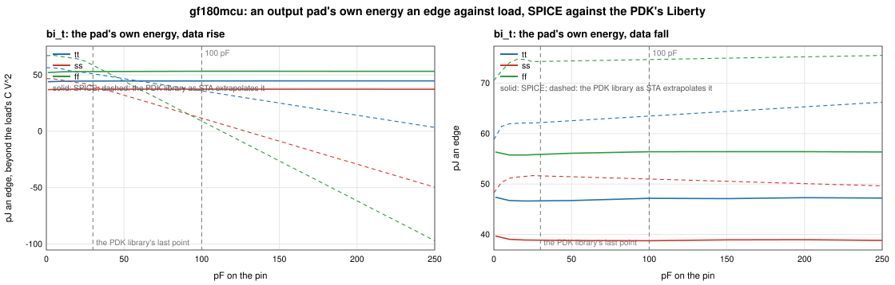

A cycle into the test load is the load's C V² and 1-4 % besides. Within
their range the libraries put the pad's own energy 13-25 % (GF180) and
9-17 % (IHP) above SPICE at every corner -- the PDKs' netlists have the
transistors and diodes but no wiring capacitance, which their libraries
were presumably characterised with. Beyond their range STA extrapolated
them to the wrong sign: GF180's rise at the slow corner comes to 11.6 pJ
at 100 pF and below zero past 130 pF, and its output enable's 0 -> Z --
C V² taken off for a pin that does not move -- to -2.08 nJ an edge at
100 pF: LibreLane's report for a GF180 chip with these pads at 100 pF had
their internal power at -1.8 W. OpenSTA 2.7 also takes a pin tied high
(`SL`) to be low when it weighs the `when` states, and weighs an output's
states alike, so the libraries keep only the states the chips tie the
cells into (the tables of the other drive strengths, fast slew and the
pulls go), each with the simulated energy.

Inputs, a cycle (pin up and down): with 1 ns edges 4.9-11.8 pJ on GF180
(its library 5.1-13.1), growing with the edge as the input's crowbar
current lasts -- 8-47 pJ with 15 ns, 33-299 pJ with 120 ns. Leakage per
state: 2.7-4.4 nW on GF180 (its library 4.6-5.8 nW), 0.2-31 nW on IHP.

IHP's libraries also get `voltage_map`s: their pins name their supply but
nothing gave its voltage, so STA took the core's 1.08-1.32 V for a pad
pin's switching power instead of the I/O's 3.0-3.6 V. IHP's
`IOPadInOut16mA` keeps its input on while it drives: its energy driving
includes the input's, which STA counts again on `p2c` (~1 % of a cycle
into 100 pF).

### Into the pin timing

`../timing/pin_timing.py` reads `pads/<pdk>/` when it is there: the
simulated libraries in place of the PDK's, outputs measured at 1.5 V (the
simulated offset from 50 % at the check's load) and inputs at 2.0 / 0.8 V
on the check's edge. The CLK pin stays referenced at its 50 %. The three
chips at 4 MHz, PDK libraries at 50 % against simulated pads at the
datasheet's levels:

| | GF180 7-track | GF180 9-track | IHP |
|---|---|---|---|
| Tightest margin | +0.6 ns (ThINT) -> +6.4 ns (ThBUSREQ) | +0.6 (ThINT) -> +6.4 (ThINT) | +0.5 (ThBUSREQ) -> +1.8 (ThBUSREQ) |
| Opcode setup TsD(Cr), slow corner | +8.9 -> +11.8 ns | +7.1 -> +10.0 | +25.2 -> +28.3 |
| WR pulse width TwWR | +31.6 -> +20.0 ns | +31.5 -> +19.8 | +30.4 -> +27.7 |
| 6 / 8 MHz, simulated pads (tightest) | PASS +6.7 / PASS +1.8 | PASS +5.0 / PASS +0.8 | PASS +1.9 / PASS +1.2 |

The input holds that looked tightest were the libraries' extrapolation:
with the inputs as simulated they have 6 ns and more on GF180. The low
pulses of the 5 V outputs come out shorter at 1.5 V (their falling edge
crosses it late, the rising one early), and all of them stay well
inside the datasheet.

### In plots

`findings.py` draws the above from `pads/<pdk>/pads.json` and from
`pin_timing.py`'s output on each chip's run with the simulated pads and
with `--pads none` (`findings/pin_timing/` holds a set):

    asic/spice/findings.py           # findings/*.svg

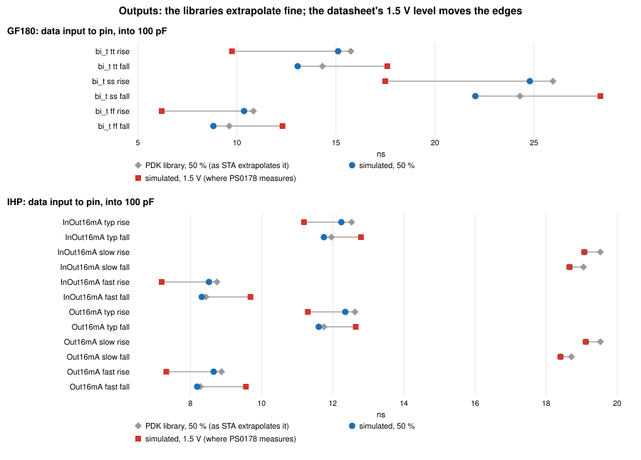

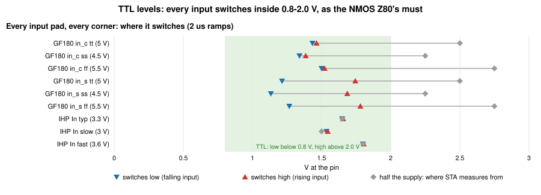

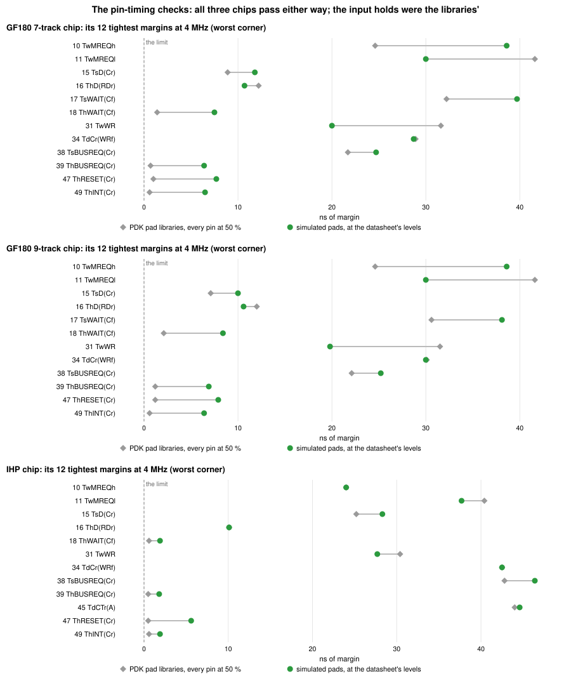

### Notes

- ngspice runs single-threaded (`.spiceinit`): its OpenMP device loading
  costs per model, and GF180's library has hundreds of binned models, so
  with the default 8 threads a pad took ~1000x as long.
- IHP's transistor models are Verilog-A (PSP 103); `pads.py` compiles them
  with `openvaf-r` into the run directory. Its antenna diodes (`darea`,
  `dperim`) carry a 0.7 µs transit time, which made ngspice's timestep
  collapse as an output switched; `pads.py` zeroes it -- the diodes sit
  reverse-biased on the output transistors' gates and keep their
  capacitance and leakage (removing them outright changes no delay by
  0.01 ns) -- and joins IHP's substrate node (`sub!`) into one.
- The loads start at 1 pF: with none at all, GF180's slow corner also
  stalls ngspice's timestep, and a pin always carries some.
- The PDK versions are the chips': GF180 `54435919` (LibreLane 3.0.14's),
  IHP `7bbb4b5a` (IHP's chip template).

## The NMI pulse catcher

The NMOS Z80 takes an NMI pulse of any width -- TwNMI, 80 ns at 4 MHz, is
less than half a clock -- because its NMI flip-flop is set by the pin's
falling edge itself, not by a clock edge sampling the pin. `z80_top` does
the same in front of the core's edge detect (`rtl/z80_top.v`): `nmi_hold`,
a flip-flop clocked by the NMI pin with D tied high, holds NMI asserted for
the core (`nmi_n_held`) until a rising CLK edge has seen it, and
`nmi_hold_clr` then clears it. It is the one place in the chips where a
pin clocks a flip-flop, and the clear races the clock edge that samples
`nmi_n_held`, so `nmi.py` simulates it.

The cut goes from the NMI and CLK pins to the first flip-flops: the two
input pads, NMI's port buffer, the clock tree from the CLK pad to the leaf
that clocks the catcher, the catcher's two flip-flops, its NOR and
inverter, and the falling-edge sampler `nmi_n_neg`. `nmi.py` finds it in
the chip's gate-level netlists by the RTL's net names and follows it back
through buffers and inverters to the pins. The cells are extracted with
Magic from the PDK's own layouts (the PDK's cell netlists carry no
junction areas, and came out too fast), the wires come from the routed
chip's SPEF,
and every net also carries the input capacitance of the cells on it that
the cut leaves out. A minute per corner, the three side by side; with
`--magic WORK` the cut comes out of `chip.py`'s extraction of the whole
chip instead, which agrees within 0.5 ns at tt (the clear within 0.1 ns).

    asic/spice/nmi.py <asic-gf180mcu chip run>     # chip/gf180mcu/nmi_*.svg, nmi_<corner>.json

Six cases at 4 MHz, 15 ns edges on both pins:

| | the NMI pulse | |
|---|---|---|
| A | 80 ns (TwNMI), in the low half of the clock | |
| B | 20 ns, a quarter of TwNMI | |
| C | falling 5 ns before a rising CLK edge | held to the edge after it |
| D | falling 5 ns after a rising CLK edge | |
| E | two 25 ns pulses before one rising edge | one NMI |
| F | a second 40 ns pulse in the high half after the edge that clears the first | lost |

A, B, E and F sit in the middle of a clock phase, clear of CLK's edges;
C and D are about the edge.

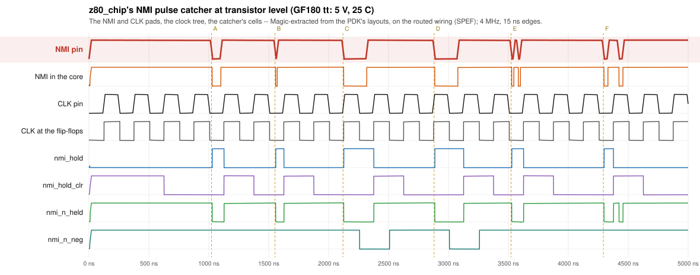

Every pulse is caught at every corner, B's 20 ns too. Case A, from the
pin's 50 % to the node's:

| | NMI pin falls -> `nmi_hold` set | CLK pin rises -> `nmi_hold_clr` | the core sees NMI for |
|---|---|---|---|
| tt, 5.0 V, 25 °C | 6.3 ns | 1.5 ns | 99.3 ns |
| ss, 4.5 V, 125 °C | 8.1 ns | 4.6 ns | 102.0 ns |
| ff, 5.5 V, -40 °C | 5.4 ns | -0.3 ns | 97.8 ns |

At ff the clear comes before the CLK pin is half-way up: on the 15 ns
edge the Schmitt pad switches near 1.8 V, its core side rising 1.7 ns
before the pin's 50 %, and the clock tree and flip-flop behind it take
less than that. Nothing depends on the pin's 50 % though -- the clear races the core's own
flip-flops, clocked by the same early edge through the same tree, and
must come after their hold time. OpenSTA times that race only through the
flip-flop's asynchronous clear arc, which it skips by default (as in the
flow's sign-off) until `set sta_preset_clear_arcs_enabled 1`: then it has
+2.0 and +2.2 ns of hold margin at tt and +1.2 and +1.3 ns at ff, for the
two flip-flops that sample `nmi_n_held`.

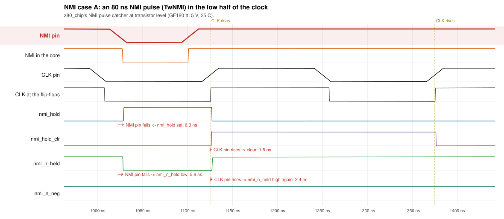

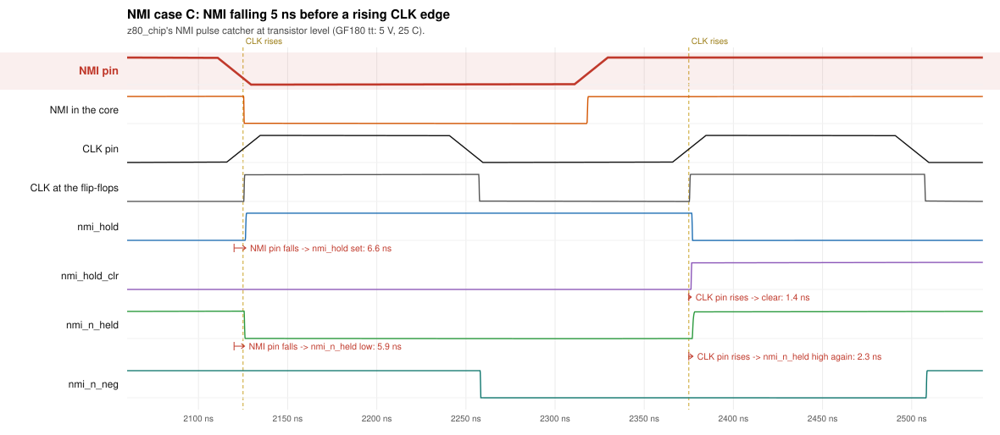

Case F: while `nmi_hold_clr` is high -- one clock -- the catcher cannot be
set, and a pulse that starts and ends inside the clock's high half is
gone before either sampler looks. On the NMOS Z80 a second falling edge
sets the NMI flip-flop again; if the first NMI is still pending, the two
are one NMI there too. Only when the core accepts the first NMI at exactly
the edge between the two pulses would the NMOS Z80 take a second one and
this chip not: two NMI pulses within a clock of each other.

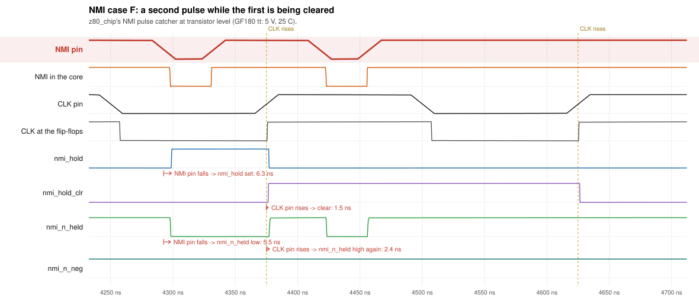

The ss and ff figures are beside them (`nmi_<case>_<corner>.svg`).
Different Magic versions extract the cells' parasitics differently
(8.3.681 moved tt's clear by 0.3 ns from 8.3.623, LibreLane 3.0.14's), so
`nmi.py` uses LibreLane's.

## The whole chip

`chip.py` extracts the GF180 7-track chip's routed layout with Magic --
66,652 transistors, leaving out the decoupling and fill cells, with every
net's wiring capacitance lumped to ground -- and runs it in ngspice from
power-up: four clocks of RESET, then a short program at 4 MHz with 15 ns
clock edges and 100 pF on every pin:

    0000  LD A,5Ah        opcode fetch, memory read
    0002  LD (8000h),A    ... memory write
    0005  OUT (42h),A     ... I/O write
    0007  IN A,(43h)      ... I/O read (the port answers A5h)
    0009  HALT

The same program on the RTL (`tb_chip_ref.v`, iverilog) gives the pins at
every clock edge, and when the memory has to drive the data bus: a source
behind a 50 Ω switch drives the RTL's byte from 40 ns after RD falls to
60 ns after the read ends. The transistors' pins are checked against the
RTL's at every clock edge after RESET, and every output parameter of the
datasheet is measured on every cycle that has it -- CLK at 50 %, outputs
at 1.5 V -- against its limit and STA's number. The figures are the
datasheet's: the opcode fetch (PS0178 Figure 5), memory read and write
(Figure 6), I/O write and read (Figure 7), and the whole run as a logic
analyser shows it.

    asic/spice/chip.py <asic-gf180mcu chip run> --corner tt --sta <pin_timing.py output>

`--corner ss` and `--corner ff` run the slow (4.5 V, 125 °C) and the fast
(5.5 V, -40 °C) corner. tt's figures and `results.json` are committed in
`chip/gf180mcu/`, ss's and ff's in `chip/gf180mcu/ss/` and
`chip/gf180mcu/ff/`:

| Corner | Pins against the RTL | AC parameters met | Closest to its limit |
|---|---|---|---|
| tt, 5.0 V, 25 °C | 0 mismatches | 25 of 25 | TwWR, 21.8 ns over |
| ss, 4.5 V, 125 °C | 0 mismatches | 25 of 25 | TwWR, 18.3 ns over |
| ff, 5.5 V, -40 °C | 0 mismatches | 25 of 25 | TwWR, 23.7 ns over |

The clock's edges need short steps. Left to its step control (on the
devices' charges), ngspice took each edge -- the CLK pad's Schmitt
trigger, the clock tree and every flip-flop behind it -- in one 1-2 ns
step, which collapses the delays inside it: at tt a flip-flop settled in
its old state (the OUT cycle's IORQ fell half a clock late), at ff
latches elsewhere flipped with their clocks still. A source that only
makes breakpoints, every 0.5 ns from just before the CLK pin crosses the
pad's threshold to 7 ns after (`clock_breaks()`), keeps those steps at
0.2 ns or less; with it no probed flip-flop changes state without an
active edge of its clock, at any corner.

The supply's ramp gets them too (`supply_breaks()`, every 0.25 ns over
its 20 ns). From its 1 ps first step ngspice doubles its steps to 1.3 ns
by 2.6 ns, where the pads' ESD diodes begin to conduct; on ws3's chip of
90bfb9d no step from there converged at tt and ff ("Timestep too small",
at a `diode_pd2nw_06v0` in a pad's CDM clamp), where the chip before it
had got through.

KLU's sparse factorisation dominates: ngspice simulates about 40 ns a
minute, some six hours for the program at tt alone; with the clock's
breakpoints and the three corners side by side on four cores, about 13
hours each.

## Other simulators

`engines.py` takes the deck `chip.py` writes for a window and runs it in
another simulator, then sets the two runs side by side (`compare`: every
output's largest difference where the reference has settled, every output
edge's 1.5 V crossing, the pins against the RTL at every clock edge). The
chip is ws3's chip_top (RZ80 in the wafer.space quarter slot, GDS of ws3
941cfbc, Transistor run 42394274800): 127,285 BSIM4 transistors once
flattened (the pads' fill and clamp devices included), 2,744 diodes,
67,817 capacitors.

    asic/spice/engines.py xyce <chip.py's deck> [--ranks 4] [--option '.options ...']
    asic/spice/engines.py compare <ngspice .dat> <other .dat> --ref-txt ref.txt [--from NS]
    asic/spice/engines.py cells inv|nand|dff N --net <chip.py's chip.net> --va <bsim4.va> --python <venv python>

### Xyce

Xyce 7.10.0 (Sandia), from the nixpkgs pin pads.py uses for ngspice: the
serial build (KLU2 through Amesos2, its default) and `xyce-parallel`
(OpenMPI). The translation changes no physics at the PDK's nominal
settings, except where noted:

- the PDK's library sections resolved into one file; `'expr'` -> `{expr}`,
  bare names in parameter values in `{}`, `PARAMS:` on `.subckt` lines,
  `temper` -> `TEMP`;
- `agauss(mean, ...)` -> its mean, and BSIM4's `mulu0` dropped: with the
  PDK's mismatch and global variation off (`sw_stat_mismatch = 0`,
  `sw_stat_global = 0`) they are exactly 0 and 1;
- every node and instance name made one Xyce name (`:` is Xyce's
  hierarchy separator; Magic's names have `/`, `[]`, `<>`);
- ngspice's `sw` (vt 2.5, vh 0.2) as a `vswitch` (von 2.7, voff 2.3, no
  hysteresis); `rshunt` (1 Tohm on every node) as 1 Tohm on the nodes
  without a DC path;
- the diodes, ngspice level 3, as Xyce's level 2: the same junction (IS,
  JSW, CJO, CJP, MJ -> M, PB -> VJ, MJSW, PHP, N, RS, BV, IBV, IK -> IKF)
  without ngspice's temperature coefficients of capacitance and potential
  (CTA, CTP, TPB, TPHP, TLEV, TLEVC) and its tunnelling current (JTUN,
  JTUNSW, NTUN, XTITUN); IKR is dropped, which ngspice disables for these
  models anyway ("IKR too small - model effect disabled"). At 25 C (tt;
  TREF 25) the coefficients do nothing; at ss and ff the pads' ESD diodes
  and the n+ resistors' junctions keep their 25 C capacitance.
- BSIM4: the PDK's NFET cards say version 4.5, the PFETs' 4.6; ngspice
  runs each in its own code (bsim4v5, bsim4v6), Xyce in its oldest, 4.6.1
  ("older than the oldest version supported in Xyce ... Using oldest").

Window 1 of ws3's 24 at tt (0-610 ns: power-up, RESET), and three
slices: A, 0-40 ns of it; B, 610-650 ns (window 2, RESET still low); C,
1735-1860 ns (window 4: MREQ and RD fall, the memory drives D, a clock
edge) -- B and C from ngspice's state in GitHub's run. One machine (i7-7700,
4 cores, 8 MB L3), two or three simulations at a time, so absolute times
are about 3x GitHub's; wall seconds (accepted + rejected steps):

| Run | ngspice-45, KLU, 4 threads | Xyce 7.10, KLU, serial | Xyce, KLU, MPI x4 |
|---|---|---|---|
| window 1 | 13,275 (1,238 + 151) | 10,030 (1,359 + 14) | |
| slice A, power-up | 7,323 (651 + 55) | 6,184 (916 + 14) | 3,879 (928 + 14) |
| slice B, quiet | 1,537 (140 + 13) | 953 (120 + 3) | 638 (120 + 3) |
| slice C, bus cycle | 2,229 (278 + 64) | 1,677 (285 + 7) | 1,364 (285 + 7) |
| memory | 2.8 GB | 2.4 GB | |
| unknowns | 71,208 | 53,271 | |

Also on slice B: ngspice with one thread, 1,073 s (its four threads only
load the devices; here they cost more than they save); ngspice's Sparse
1.3 instead of KLU (`.options sparse`), 14,512 s; Xyce's Basker, below.
Xyce over MPI gives the same steps and the same pins as serial Xyce
(1e-14 V).

Both spend their time in the sparse LU: ngspice's window 1, 12,153 s of
13,221 s factoring (4,950 Newton iterations, 2.45 s each; GitHub's run
0.70 s each), 813 s loading the devices on 4 threads (it uses 1.1 cores);
Xyce's, 8,244 s in 4,445 linear solves (1.85 s each), 1,670 s loading the
devices on one core. Against ngspice (the same deck; GitHub's run and
this machine's are bit-identical):

| Xyce against ngspice, tt | window 1 | slice A | slice B | slice C |
|---|---|---|---|---|
| largest settled difference, outputs | 4.6 mV | 2.2 mV | 7.7 mV | 0.15 V (D[5], see below) |
| output edges at 1.5 V | 8 of 8, within 9.2 ps | 8 of 8, within 9.2 ps | none | 7 of 7, within 82 ps |
| pins against the RTL | 0 mismatches (ngspice 0) | 0 (0) | 0 (0) | 0 (0) |

Slice C's 0.15 V is D[5] while the test bench's memory switch turns on
(ngspice's `sw` with hysteresis, Xyce's smooth `vswitch`): settled, 0.03 V.
Starting from ngspice's state, Xyce ignores ngspice's `c_moscap_int1`
nodes (8,968 of 61,397): ngspice makes the PDK's voltage-dependent moscap
capacitors (`c={... v(1,2) ...}`) with an internal node, Xyce has none;
their state is their terminals', which Xyce takes.

Xyce's Basker (`.options linsol type=basker`, 4 threads asked for) on
slice B was stopped by hand after 7 h 04 min: 11 steps, 0.146 ns of the
40 ns (0.4 %), steps of the usual size (32 ps) taking about 40 min each,
on one core. `type=basker` is Amesos2's old templated, serial Basker
(Xyce's N_LAS_Amesos2Solver.C); the threaded one is `type=shylu_basker`,
which needs a Trilinos with ShyLU-node Basker -- nixpkgs' has neither
that nor Kokkos threads (`KOKKOS_ENABLE_SERIAL` only). KLU takes 953 s
for the same slice.

#### Where the linear solves go

Xyce's `type=klu` is Amesos' KLU (`Amesos_Klu`), a full factorisation at
every Newton iteration (`KLU_REPIVOT`, default 1). Slice B's 454 solves
take 595 s, 1.31 s each. Its matrices (`.options linsol output_ls=1`, a
0.06 ns run), factored outside Xyce with SuiteSparse 7.10's KLU
(`klu/kluprof.c`, `klu/kluorder.c`), take the same:

- 53,271 unknowns, 445,670 nonzeros (8.4 a row); BTF finds 462 blocks,
  433 of them 1x1 and one of 50,328 -- the core is one strongly connected
  block;
- KLU (AMD, BTF): L+U 4.24 M nonzeros (9.5x the matrix), 3.07 GFlop;
  factor 1.31 s, refactor (same pivots) 1.26 s, solve 5 ms. Xyce's time
  is the factorisation, and KLU is doing it at its usual 2.4 GFlop/s:
  the matrix is expensive, not the solver slow. Repivoting costs 5 %.

What the fill is not (each a diagnostic, not a circuit):

| Removed | L+U | GFlop | KLU factor |
|---|---|---|---|
| nothing | 4.24 M | 3.07 | 1.31 s |
| p_vdd, p_vss and their sources (42,474 and 39,584 entries) | 4.24 M | 3.07 | 1.30 s |
| also the largest signal net (buf_2_144's Z, 1,916 entries) | 4.20 M | 3.14 | 1.36 s |

AMD already orders the two supply rows last. The coupling capacitors are
not in the deck (chip.py lumps all 41,800 to ground: 10,211 capacitors to
0), and the PDK's moscaps (`cap_nmos_06v0`, in the pads only) are two
terminal elements with a fixed C's pattern. The fill is the core's own
connectivity: transistors tie each cell's nets, and a logic netlist has
large separators. The ordering, then, and the factorisation:

| Same matrix | L+U | GFlop | Factor |
|---|---|---|---|
| KLU, AMD (Xyce's) | 4.24 M | 3.07 | 1.31 s |
| KLU, COLAMD | 43.5 M | -- | 50.3 s |
| KLU, METIS on A+A' (CHOLMOD's) | 3.08 M | 1.04 | 0.45 s |
| KLU, nested dissection (CHOLMOD's NESDIS) | 3.03 M | 0.98 | 0.40 s |
| UMFPACK, AMD, 1 thread (multifrontal, OpenBLAS) | 4.40 M | 3.07 | 0.200 s |
| UMFPACK, METIS, 1 thread | 3.14 M | 1.03 | 0.115 s |
| UMFPACK, METIS, 4 BLAS threads | 3.14 M | 1.03 | 0.108 s |

A nested-dissection ordering cuts the work 3x; a solver that does it in
dense blocks (BLAS-3) another 3-6x: 11x in all, one core. Slice B's
linear solves would take about 50 s instead of 595 s, the slice about
250 s instead of 799 s (its 150 s of device loading then the larger
part). Xyce has no METIS ordering for KLU; its Amesos wrapper reaches
UMFPACK if Trilinos is built with it (below).

#### A Trilinos with threads

`nix/xyce-threaded.nix` builds the same Xyce 7.10 (serial) against
nixpkgs' Trilinos with Kokkos' OpenMP, ShyLU-node Basker (METIS for its
nested dissection) and Amesos' UMFPACK, and three small patches: omp.h
included first (with `-fopenmp`, SuiteSparse_config.h pulls it in where
Trilinos includes amd.h inside `extern "C"`); Xyce's `type=umfpack`
mapped to `Amesos_Umfpack`; and `AMESOS_UMFPACK_ORDERING=metis` to make
Amesos order with METIS instead of UMFPACK's default. Its headers have
`KOKKOS_ENABLE_OPENMP`, `HAVE_AMESOS2_SHYLU_NODEBASKER`,
`HAVE_SHYLU_NODEBASKER_METIS`, `HAVE_AMESOS_UMFPACK`.

Slice B, 40 ns, each run alone on the machine, all with that build:

| `.options linsol` | Threads | Wall | Linear solves | Each |
|---|---|---|---|---|
| `type=klu` (as before) | 1 | 808 s | 601 s | 1.32 s |
| `type=shylu_basker` | 1 | 502 s | 301 s | 0.66 s |
| `type=shylu_basker` | 2 | 631 s | 428 s | 0.94 s |
| `type=shylu_basker` | 4 | 604 s | 399 s | 0.88 s |
| `type=umfpack` (AMD) | 1 | 308 s | 100 s | 0.22 s |
| `type=umfpack`, METIS | 1 | 272 s | 65 s | 0.144 s |
| `type=umfpack`, METIS | 4 (BLAS) | 271 s | 64 s | 0.142 s |

(`OMP_NUM_THREADS`, `OMP_PROC_BIND=true` for Basker; `OPENBLAS_NUM_THREADS`
for UMFPACK.) Every run takes the same 120 + 3 steps and 454 solves, and
prints the same outputs as KLU's to every printed digit. On the bus-cycle
slice C (125 ns, 285 + 7 steps, 993 solves), UMFPACK with METIS takes
543 s (143 s of solves) and Basker on one thread 1,038 s (659 s), against
KLU's 1,677 s (1,299 s; the earlier run, not alone on the machine): the
same steps, 7 of 7 output edges with no shift, 1e-14 V, 0 mismatches with
the RTL.

Basker's threads make it slower, not faster -- likely because one block
holds 94 % of the matrix and its top separator is factored by one thread
while the others wait (not measured). On one thread it is twice KLU's
speed, about what METIS's ordering gives KLU itself (0.45 s above). UMFPACK with METIS gives the
slice 3.0x (B) and 3.1x (C) on one core, the linear solves 9x; what is
left is mostly loading the devices (150 s of B's 272 s), the part MPI
spreads.

The threaded build starts 8 OpenMP threads (Epetra's vector operations)
that spin in barriers for the whole run; `OMP_NUM_THREADS=1` takes slice B
with UMFPACK + METIS from 272 s to 259 s (the residual load 129.9 -> 124.1
s, the linear solves 65.4 -> 60.0 s, the same steps). Every run below sets
it.

#### Over MPI, with UMFPACK

`nix build -f nix/xyce-threaded.nix --arg mpi true` is the same over
OpenMPI (Zoltan's METIS interface off: it needs ParMETIS).
`AMESOS_UMFPACK_TIMING=1` prints Amesos' own timing at the end. The
devices' loads are spread over the ranks; Amesos gathers the matrix to
rank 0 at every factorisation, where UMFPACK runs alone. Slice B,
`type=umfpack`, METIS, `OMP_NUM_THREADS=1` and OpenBLAS on one thread a
rank, oversubscription allowed as in the earlier MPI sweep:

| Ranks | Wall | Residual load | Jacobian load | Linear solves | of which: gather to rank 0 | UMFPACK factor + solve |
|---|---|---|---|---|---|---|
| 1 | 266 s | 127 s | 23.4 s | 60 s | 0.003 s | 59.1 s |
| 2 | 210 s | 75 s | 19.8 s | 74 s | 12.6 + 0.8 s | 59.4 s |
| 3 | 188 s | 59 s | 16.0 s | 76 s | 13.1 + 1.0 s | 60.8 s |
| 4 | 176 s | 49 s | 14.0 s | 79 s | 13.7 + 1.1 s | 62.9 s |

(gather: the matrix + the vectors, 454 times; converting it to UMFPACK's
format, 0.7 s, and the one symbolic factorisation, 0.4 s, are the rest.)
The loads spread 2.6x over 4 ranks; gathering the matrix costs 14-15 s
from 2 ranks on, 30 ms a factorisation. Four ranks: 176 s, 4.6x KLU's
808 s serial and 3.6x the earlier KLU over 4 ranks (638 s). Slice C over
4 ranks: 351 s (109 s residual, 31 s Jacobian, 172 s solves, 32 s of it
the gather), against 543 s serial UMFPACK and KLU's 1,677 s; the same
285 + 7 steps, 7 of 7 output edges with no shift against either, 1e-14 V,
0 mismatches with the RTL. Slice B's outputs equal KLU's and serial
UMFPACK's to every printed digit.

A smaller deck of chip_top's own cells (a Schmitt input pad, inverters, a
dffrnq, a bi_t output pad with 100 pF) shows where the two differ: with
20 ps steps both put every edge within 4-11 ps of each other; at their
default tolerances Xyce stays within about 70 ps of that, ngspice moves an
inverter's edge by up to 320 ps (the coarse steps `clock_breaks()` keeps
off the chip's clock edges).

Not run: ss and ff, and windows after the first in Xyce's own chain (each
slice above starts from ngspice's state).

### VAJAX

VAJAX (ChipFlow; JAX, Verilog-A through OpenVAF; git head 2dfc407, its
`openvaf-py` 0.1.5, JAX 0.9.2) has no BSIM4 of its own (its models:
PSP103, BSIM-BULK, BSIM-CMG, BSIM-IMG, EKV, HiSIM2, ASM-HEMT, MVSG, R, C,
L, diodes; its SPICE converter maps level 54 to a `bsim4.osdi` it does not
have and drops the device without a word). `engines.py cells` gives it a
BSIM4 as Verilog-A and writes its `.sim` itself:

- the Verilog-A: VA-BSIM48 (cogenda, BSIM4.8 from Berkeley's C; the copy
  OpenVAF's tests carry). It is CC BY-NC-SA 4.0 and not in this
  repository: `--va` points at it;
- the cards: the PDK's `nfet_06v0.N` / `pfet_06v0.N` (what `nfet_05v0`
  and `pfet_05v0` instantiate) with every expression evaluated at the
  corner, one VAJAX model per bin, the bin per transistor as ngspice picks
  it (lmin <= L < lmax, wmin <= W < wmax), each transistor's W, L, AD, AS,
  PD, PS as Magic extracted them; the cells flattened, their lumped
  capacitors as `sp_capacitor`;
- `BSIM4_VA_FIXES`: VA-BSIM48 never defaults `wk2` when the card has none
  (it does `lk2`, `pk2`): k2 = k2 + wk2 / Weff with wk2 at its NOT_GIVEN
  mark, -12345789, so k2ox is about -1e7 and Abulk clamps at 0.05; with
  `wk2 = 0` the VA, compiled to OSDI by OpenVAF 24.0.1 and loaded into
  ngspice, gives ngspice's own BSIM4 4.8 drain current to 5 digits, and
  its 4.5 to 1e-4 (NFET bin 0, W/L 1/1, 1/10, 10/1 um).

That alone does not make the transistors carry current in VAJAX: its
engine has five faults with this model, each patched locally (in the
venv, not here; `vajax-bsim4-local.patch`, 5 files, about 150 lines):

1. node collapse decisions out of step with the collapsible pairs: init
   returns one flag per (pair, condition), and BSIM4's rgateMod `case`
   reaches two pairs from two branches, so pair k read flag k of a longer
   list (the gate's and body's internal nodes left floating, the
   collapsed branches' currents kept as 0 = 0 rows). Fixed: a pair
   collapses when any of its conditions holds; a branch current (to
   ground, `u32::MAX`) with its branch's nodes;
2. internal node `node4` taken as PSP103's NOI node on every device and
   clamped to 0 V: in BSIM4 `node4` is `di`, collapsed onto the drain, so
   every drain was held at 0 V (the "0.0 V at the output" before). The
   same lists also kept collapsed nodes -- the drain -- out of the
   residual check. Fixed: NOI only where the model's first internal node
   is NOI, and only nodes the device got for itself count as internal;
3. init inputs mapped to eval columns by lowercase name, where a hidden
   state shares a parameter's name (parameter `tnom`, variable `Tnom`;
   `mjs`, ...): init read 0 for them (Tnom 273.15 K, the drain junction's
   grading 0). Fixed: a parameter's own column first;
4. a device whose card has not a parameter another card of the same
   module has (the NFET and PFET cards) got 0 for it, which the VA reads
   as given. Fixed: the module's default;
5. the Jacobian: the translated OpenVAF derivatives of this model are
   wrong at every bias -- dId/dVd 1e22 S at Vgs = 0, 1e57 S at Vgs = 2 V,
   NaN in triode -- while the residuals match finite differences (and
   ngspice). Not fixed in the translator: the patch replaces the node
   voltage columns of the device's Jacobian (resistive and reactive) by
   JAX forward-mode autodiff of its own residuals over its 20 branch
   voltages (`VAJAX_AD_JAC=bsim4va`); the branch-current columns keep the
   MIR's +-1.

With these, at DC: a 0.82/0.6 NFET, a 0.82/1 NFET and a 1.22/0.5 PFET on
10 k loads come out within 0.6 mV of ngspice (ngspice's own BSIM4).

On chip_top's own cells (`engines.py cells`: chip.py's extracted
`inv_1`, `nand2_1`, `dffrnq_1` with their lumped capacitors; tt, 25 C;
ngspice and Xyce at their default tolerances, VAJAX at its own, all three
with ngspice's 0.1 ns step cap; edges at 2.5 V, settled: where the
reference moves less than 1 mV within 0.5 ns):

| Circuit | transistors | VAJAX vs ngspice | Xyce vs ngspice | VAJAX vs Xyce |
|---|---|---|---|---|
| 1 inv_1 | 2 | 3.6 ps, 0.18 mV | 12 ps, 0.18 mV | 0.5 ps, 0.01 mV |
| 1 nand2_1 | 4 | 8.1 ps, 0.34 mV | 8.8 ps, 0.34 mV | 8.8 ps, 0.01 mV |
| 10 inv_1 | 20 | 21 ps, 0.20 mV | 25 ps, 0.20 mV | 6.8 ps, 0.00 mV |
| 4-bit dffrnq_1 register, 100 MHz | 112 | 6.1 ps, 0.26 mV | 5.9 ps, 0.26 mV | 3.0 ps, 0.05 mV |
| 100 inv_1, from 0 V | 200 | 516 ps, 0.77 mV | 585 ps, 11 mV | 89 ps, 0.01 mV |

(edges: the largest difference of all; every edge found in every run.)
On the 100-stage chain ngspice is the odd one out (404 steps, 79
rejected, against Xyce's 1,687 and VAJAX's 779): its default steps move
the edge, as on the chip ("Xyce" above).

Per step on this machine's CPU (i7-7700, the machine to itself, one
thread each, `engines.py cells`; VAJAX: its second transient run, the
first compiles, over accepted steps; Xyce: its solvers' time; ngspice:
its analysis time):

| Circuit | transistors | VAJAX ms/step | Xyce ms/step | ngspice ms/step |
|---|---|---|---|---|
| 1 inv_1 | 2 | 0.83 | 0.044 | 0.012 |
| 1 nand2_1 | 4 | 1.02 | 0.052 | 0.019 |
| 10 inv_1 | 20 | 2.14 | 0.10 | 0.060 |
| 4-bit dffrnq_1 register | 112 | 7.77 | 0.47 | 0.38 |
| 100 inv_1, from 0 V | 200 | 20.8 | 0.72 | 0.97 |
| 32-bit dffrnq_1 register (*) | 896 | 49.5 (sparse) | 4.1 | |
| 1,000 inv_1, from 0 V (*) | 2,000 | 134 (sparse) | 12.8 | |

(*) two copies of the timing run shared the CPU: approximate. VAJAX's
compiling (the BSIM4 Verilog-A to JAX, then XLA) adds about 65 s a run
before the first step; up to 200 transistors it uses its dense solver,
past 400 its sparse one. On the 1,000-inverter chain only `n1`'s edges
compare (within 8 ps, Xyce and VAJAX alike): started from 0 V the chain
is metastable -- Xyce and VAJAX hold `n500` at the 2.10 V trip point for
several ns, ngspice resolves it at once -- and the input's edges do not
reach `n500` or `n1000` within the 30 ns, so the settled differences
there (2-5 V) are the start, not the models. The 4-thread VAJAX runs
were not done.

So VAJAX solves this PDK's cells correctly once patched, and it is about
10-30x slower per step than Xyce on the CPU, plus its compile time. At
the chip's 127,285 transistors a linear extrapolation from 2,000 gives
about 8 s a step for VAJAX alone, before the fill-in that makes the
chip's sparse LU dominate in ngspice and Xyce (7.3 s a step for Xyce/KLU
on window 1); that is a lower bound, not a forecast. Its GPU path does
not help here (the GTX 1080: 8 GB, float64 at 1/32 rate; GitHub's
runners have no GPU). VAJAX is out for the whole chip on this machine
and in CI.

Two more limits of VAJAX here: its transient takes the DC point by plain
Newton from mid-rail -- the homotopy (gdev, gshunt, source stepping) its
`op` analysis has is not used -- and on 100 inverters that diverges
(1e20 V) and the transient never recovers; and its own SPICE converter
still cannot read the PDK (no `M` lines, no binning, `.control` blocks).
`engines.py cells` writes the `.sim` itself and starts circuits past 150
transistors from 0 V in all three engines.

### So

Xyce runs ws3's chip as ngspice does -- the same pins, 0 mismatches with
the RTL, edges within 10 ps (82 ps where the test bench's switch differs)
-- and on this machine serial Xyce takes 0.6-0.85 of ngspice's time, over
four MPI ranks 0.4-0.6. Both are bound by one sparse LU; Xyce's is smaller
(fewer unknowns) and does fewer of them (fewer rejected steps). Built
with UMFPACK and given METIS (`nix/xyce-threaded.nix`), Xyce's LU is 9x
faster and the slices 3x, the same outputs. Its costs:
one more tool (nixpkgs has both builds), the translation above (the
diodes' temperature coefficients at ss and ff, BSIM4 4.6.1 for the PDK's
4.5 / 4.6). VAJAX matches both on chip_top's cells, but only with a fixed
BSIM4 Verilog-A that may not be shipped here and five local patches to
VAJAX itself, and it does not yet reach the chip (no DC homotopy in its
transient, its converter, 127,285 BSIM4 instances on an 8 GB GPU).

## CI

- `targets.yml`'s `spice` job (`.github/workflows/spice-pads.yml`, ~10 min a
  PDK): `pads.py --check` for GF180 and IHP against the committed
  `pads.json`, its figures as the artifact `spice-pads-<pdk>`.
- `asic-pdk.yml`, GF180 7-track: after the chip's pin timing, `nmi.py`
  at three corners (~2 min), failing when a case's pulse is not caught,
  held for the core and cleared.
- `ci.yml`, the iverilog job: `make chip_sim_check` (`test_chip.py`)
  runs `chip.py`'s simulate with a stand-in for ngspice: a window ngspice
  aborted, or whose data stops before its end, has to fail, and the
  supply's ramp has to have its breakpoints.
- `pages.yml` puts the pads, the NMI catcher and the committed whole-chip
  runs under "At transistor level" on the project's site, and the latest
  `transistor.yml` run on its own page, `transistor/`, linked from there.
- `transistor.yml`, by hand (Actions, "Transistor", Run workflow): the
  whole chip at the three corners. It extracts the GDS of main's latest
  Targets run, runs the program in four windows of about 3.3 µs, one job
  each (a job stops at 6 hours; `chip.py --segment K/4`), and puts the
  stitched run's figures and `results.json` in the artifact
  `transistor-gf180mcu`, laid out as `chip/gf180mcu/`.

A window starts from the node voltages the one before ended with
(ngspice's `wrnodev`, as `.ic`), with every source shifted to its start.
The cuts sit 15 ns before a clock edge, where the chip has settled.
`wrnodev` leaves out every node whose name has a `#` -- ngspice keeps those
for devices' own internal nodes -- and Magic names every node inside a
standard cell that way, so the first run on GitHub restarted each window
with the latches inside every flip-flop at 0 V: its pins left the RTL's at
the first clock edge after the first cut. `chip.py` renames them
(`a_<x>_<y>_h`); a flip-flop restarted while its clock is high keeps its
state. A window fails when ngspice aborted it or its data stops before
the window's end: an aborted transient still writes the points it
reached and `wrnodev`'s state, and ws3's run 40864340281 started a window
from the state 2.6 ns into the power-up that way. A run whose pins differ
from the RTL's or that fails an AC parameter fails, and `pages.yml` publishes no such run. ngspice's own
snapshots (`snsave` / `snload`) would keep the integrator's history too,
but `snload` crashes on a KLU circuit.
